# 📋 Implementation Plan & Requirement Specification: Claude GitHub App Integration (`claude.yml` & Automated `pr-review.yml` Auto-Fix & Squash-Merge Pipeline)

## 📝 Context & Problem Statement

Based on Product Owner design review (`/grill-me`) and the reference implementation in [`AntaresAndBharani/darwin-trader`](https://github.com/AntaresAndBharani/darwin-trader):

1. **Missing Interactive `@claude` GitHub App Workflow (`.github/workflows/claude.yml`)**:
   - Currently, `AntaresAndBharani/crosstrainingapp` only defines [`build.yml`](file:///c:/Users/rogal/workspaces/ws-gym/crosstrainingapp/.github/workflows/build.yml) (`PR CI & Test Verification`) and [`release.yml`](file:///c:/Users/rogal/workspaces/ws-gym/crosstrainingapp/.github/workflows/release.yml) (`Release on Merge to Main`).
   - Maintainers cannot mention `@claude` in GitHub Issues, Issue Comments, Pull Request Reviews, or PR Review Comments to trigger interactive Claude Opus 5.5 (`--model claude-opus-5-5 --effort high`) sessions directly on GitHub.com.
2. **Missing Automated PR Review, In-Place Auto-Fix & Squash-Merge Pipeline (`.github/workflows/pr-review.yml` & `.github/workflows/prompts/pr-review.md`)**:
   - Pull Requests opened in `crosstrainingapp` do not currently undergo automated Claude Opus 5.5 High architectural review, in-place auto-fixing (`[skip pr-review]`), self-healing label governance, exact-SHA CI gating against `PR CI & Test Verification`, automatic squash-merging, and parent-story closure.

---

## 🤝 Aligned Design Decisions (`/grill-me` Consensus)

1. **Dual-Workflow Scope (`claude.yml` + `pr-review.yml` + `prompts/pr-review.md`)**:
   - Integrate **both** the interactive `@claude` mention workflow (`.github/workflows/claude.yml`) and the unified automated PR review, in-place auto-fix, exact-SHA CI verification, and squash-merge workflow (`.github/workflows/pr-review.yml` + `.github/workflows/prompts/pr-review.md`) modeled on `AntaresAndBharani/darwin-trader`.
2. **Lightweight Runner Environment (No Redundant JDK/Gradle Setup in Claude Workflows)**:
   - Keep both `claude.yml` and `pr-review.yml` lightweight without pre-installed JDK 17 or Gradle setup steps.
   - In `pr-review.yml`, Claude Opus 5.5 High inspects `pr_meta.json`, `pr_diff.txt`, and the repository source files (`Read,Write,Edit,MultiEdit,Grep,Glob,Bash`), applies any code, unit-test, PowerShell script, or documentation fixes directly in the working tree (and can run `pwsh -NoProfile -File ./scripts/tests/Invoke-ScriptTests.ps1` if scripts/workflows are modified), and writes `pr_review_output.json`.
   - Full Android JVM unit test and cross-platform script verification is executed by the existing [`build.yml`](file:///c:/Users/rogal/workspaces/ws-gym/crosstrainingapp/.github/workflows/build.yml) (`PR CI & Test Verification`) workflow, which `pr-review.yml` strictly polls for `--commit "$CURRENT_SHA"` before merging.
3. **Self-Healing Label Parity + CrossTraining Orchestrator Compatibility**:
   - Retain exact `darwin-trader` label parity (`review:approved`, `review:changes-requested`, `status:needs-po-input`, `status:ready`, `status:done`, `tech-debt`) with idempotent `gh label create <name> -R "$REPO" --force` (`ensure_label`) before any label operation so missing labels never crash the workflow.
   - Additionally, for CrossTraining orchestrator compatibility ([`GEMINI.md`](file:///c:/Users/rogal/workspaces/ws-gym/crosstrainingapp/GEMINI.md#L33-L41)):
     - Ensure and apply `needs-refactor` alongside `review:changes-requested` whenever a PR receives a `CHANGES_REQUESTED` verdict or when CI fails/times out on `CURRENT_SHA`, and remove `needs-refactor` when `review:approved` is applied.
     - Ensure and apply `dev-implemented` alongside `status:done` (while removing `ready-for-dev` and `status:ready`) when closing a completed parent story.
4. **Preserve `build.yml` Workflow Name (`PR CI & Test Verification`)**:
   - Keep `.github/workflows/build.yml` named `PR CI & Test Verification` to preserve `GEMINI.md` documentation and branch protection compatibility.
   - Configure `pr-review.yml` to poll `gh run list -R "$REPO" --commit "$CURRENT_SHA" -w "PR CI & Test Verification" -L 1` for up to 60 attempts at 10-second intervals (10 minutes max) and require an explicit `CI_PASSED="true"` (`completed:success`) gate before executing `gh pr merge "$PR_NUMBER" -R "$REPO" --squash --delete-branch`.
5. **Cross-Platform Static Regression Test Coverage (`scripts/tests/ClaudeWorkflows.Static.Tests.ps1`)**:
   - Add a deterministic PowerShell static test suite in `scripts/tests/ClaudeWorkflows.Static.Tests.ps1` (auto-discovered by [`scripts/tests/Invoke-ScriptTests.ps1`](file:///c:/Users/rogal/workspaces/ws-gym/crosstrainingapp/scripts/tests/Invoke-ScriptTests.ps1) and [`build.yml`](file:///c:/Users/rogal/workspaces/ws-gym/crosstrainingapp/.github/workflows/build.yml)) verifying the structural, concurrency, fast-path, self-healing label, and exact-SHA CI polling contracts of `claude.yml`, `pr-review.yml`, and `.github/workflows/prompts/pr-review.md`.

---

## 🏗️ Target Architecture & Workflow State Machine

```mermaid
flowchart TD
    subgraph Interactive ["1. Interactive @claude Workflow (.github/workflows/claude.yml)"]
        Mention["@claude mention in issue_comment, pull_request_review_comment,\npull_request_review, or issues (opened/assigned)"] --> Checkout1["actions/checkout@v4 (fetch-depth: 1)"]
        Checkout1 --> ClaudeInteractive["anthropics/claude-code-action@v1\n(--model claude-opus-5-5 --effort high)"]
    end

    subgraph AutomatedPR ["2. Automated PR Review & Auto-Merge (.github/workflows/pr-review.yml)"]
        Trigger["PR Event (opened, synchronize, ready_for_review, reopened)\nor workflow_dispatch(pr_number)"] --> Meta["Step: Check PR state, loop cap & skip markers (steps.meta)"]
        Meta -->|"STATE != OPEN or Draft"| ExitNoOp["Exit 0 (skip=true)"]
        Meta -->|"LAST_MSG contains [skip pr-review]\nAND latest verdict == APPROVED"| MergeOnly["Fast-Path (merge_only=true, 0 LLM tokens):\nEnsure review:approved & remove needs-refactor"]
        Meta -->|"LAST_MSG contains [skip pr-review]\nAND not APPROVED"| ExitNoOp
        Meta -->|"ROUNDS >= ROUND_CAP (3)"| Escalate["Ensure & add status:needs-po-input\nPost escalation comment & Exit 0"]
        Meta -->|"Needs Review (skip=false, merge_only=false)"| FetchCtx["Checkout PR Branch (fetch-depth: 0)\n+ Fetch pr_meta.json & pr_diff.txt"]
        FetchCtx --> ClaudeReview["Run Claude Opus 5.5 High Review & In-Place Auto-Fix\n(.github/workflows/prompts/pr-review.md)"]
        ClaudeReview --> CommitStep["Commit & Push Auto-Fixes ([skip pr-review])\nUpdate CURRENT_SHA"]
        CommitStep --> PostVerdict["Post Verdict Comment\nIdempotently Create & Apply Labels\nCreate Follow-up Backlog Issues"]
        PostVerdict -->|"verdict == CHANGES_REQUESTED"| ExitChanges["Apply review:changes-requested + needs-refactor\nExit 0"]
        PostVerdict -->|"verdict == APPROVED"| PollCI["Wait for 'PR CI & Test Verification' Run\nwhere headSha == CURRENT_SHA (Max 60 x 10s = 10 min)"]
        MergeOnly --> PollCI
        PollCI -->|"CI_PASSED == true"| SquashMerge["gh pr merge --squash --delete-branch"]
        PollCI -->|"CI Failed or Timed Out"| CIFail["Swap label to review:changes-requested + needs-refactor\nPost CI Failure Comment & Exit 1"]
        SquashMerge --> CloseStory["Check Linked Subtask & Parent Story\nApply status:done + dev-implemented & Close if 0 Open Siblings"]
    end
```



---

## 📂 Component Impact Table

| File / Resource | Action | Responsibility |
| :--- | :--- | :--- |
| `.github/workflows/claude.yml` | **Create** | Interactive `@claude` GitHub App workflow triggered on `issue_comment`, `pull_request_review_comment`, `pull_request_review`, and `issues`, invoking `anthropics/claude-code-action@v1` with `--model claude-opus-5-5 --effort high`. |
| `.github/workflows/pr-review.yml` | **Create** | Unified automated PR review, in-place auto-fix (`[skip pr-review]`), zero-token `merge_only` recovery fast-path, idempotent self-healing label governance (`review:*`, `status:*`, `needs-refactor`, `dev-implemented`, `tech-debt`), exact-SHA polling of `PR CI & Test Verification`, squash-merge, and parent-story closure workflow. |
| `.github/workflows/prompts/pr-review.md` | **Create** | CrossTraining-tailored review & auto-fix instructions for Claude Opus 5.5 High covering MVVM/UDF architecture, Room migration/schema parity, Cloud Sync tombstone safety, analytics rounding invariants, Compose UI/TalkBack accessibility, PowerShell script hygiene, and `pr_review_output.json` schema output. |
| `scripts/tests/ClaudeWorkflows.Static.Tests.ps1` | **Create** | Cross-platform PowerShell static regression test suite verifying `claude.yml`, `pr-review.yml`, and `.github/workflows/prompts/pr-review.md` contracts via `Invoke-ScriptTests.ps1`. |
| `CHANGELOG.md` | **Modify** | Document the Claude GitHub App integration (`claude.yml`, `pr-review.yml`, `prompts/pr-review.md`, and `ClaudeWorkflows.Static.Tests.ps1`) under `## [Unreleased]`. |

---

## 🎯 Final Decision Plan & User Story Specification

### Title
`feat(ci): integrate Claude GitHub App workflows (claude.yml & automated pr-review.yml auto-fix and squash-merge)`

### Sizing & Pattern Classification
- **Pattern:** **Pattern A (Standalone Task, $\le 5$ files)**
- **Files Touched:** 5 files (`.github/workflows/claude.yml`, `.github/workflows/pr-review.yml`, `.github/workflows/prompts/pr-review.md`, `scripts/tests/ClaudeWorkflows.Static.Tests.ps1`, `CHANGELOG.md`)

### User Story
**As a** project maintainer of CrossTraining (`AntaresAndBharani/crosstrainingapp`)
**I want** the Claude GitHub App integrated via `.github/workflows/claude.yml` (interactive `@claude` mentions) and `.github/workflows/pr-review.yml` + `.github/workflows/prompts/pr-review.md` (automated Claude Opus 5.5 High PR review, in-place auto-fix, self-healing label management, exact-commit CI gating against `PR CI & Test Verification`, squash-merge, and parent-story closure)
**So that** I can collaborate with Claude Opus 5.5 directly on Issues/PRs and have every non-draft Pull Request automatically reviewed, fixed in place, verified against CI on the exact target commit SHA, and squash-merged without self-cancellation or missing-label failures.

---

## 📐 Detailed Technical Specifications

### 1. Interactive `@claude` Workflow (`.github/workflows/claude.yml`)

Create `.github/workflows/claude.yml` matching `AntaresAndBharani/darwin-trader`:

```yaml
name: Claude Code

on:
  issue_comment:
    types: [created]
  pull_request_review_comment:
    types: [created]
  issues:
    types: [opened, assigned]
  pull_request_review:
    types: [submitted]

jobs:
  claude:
    if: |
      (github.event_name == 'issue_comment' && contains(github.event.comment.body, '@claude')) ||
      (github.event_name == 'pull_request_review_comment' && contains(github.event.comment.body, '@claude')) ||
      (github.event_name == 'pull_request_review' && contains(github.event.review.body, '@claude')) ||
      (github.event_name == 'issues' && (contains(github.event.issue.body, '@claude') || contains(github.event.issue.title, '@claude')))
    runs-on: ubuntu-latest
    permissions:
      contents: write
      pull-requests: write
      issues: write
      id-token: write
      actions: read
    steps:
      - name: Checkout repository
        uses: actions/checkout@v4
        with:
          fetch-depth: 1

      - name: Run Claude Code (Opus 5.5 High)
        id: claude
        uses: anthropics/claude-code-action@v1
        with:
          claude_code_oauth_token: ${{ secrets.CLAUDE_CODE_OAUTH_TOKEN }}
          claude_args: '--model claude-opus-5-5 --effort high'
          additional_permissions: |
            actions: read
```

### 2. Automated PR Review, Auto-Fix & Squash-Merge Workflow (`.github/workflows/pr-review.yml`)

Create `.github/workflows/pr-review.yml` with the following exact lifecycle guarantees:

1. **Triggers & Concurrency**:
   - `on.pull_request.types: [opened, synchronize, ready_for_review, reopened]`
   - `on.workflow_dispatch.inputs.pr_number` (`required: true`, `type: string`)
   - `concurrency`:
     ```yaml
     concurrency:
       group: pr-review-${{ github.event.pull_request.number || inputs.pr_number }}
       cancel-in-progress: false
     ```
   - `permissions`: `contents: write`, `issues: write`, `pull-requests: write`, `id-token: write`, `actions: read`.
   - `env`: `ROUND_CAP: 3`, `VERDICT_MARKER: "<!-- pr-review-verdict -->"`, `CI_WORKFLOW_NAME: "PR CI & Test Verification"`.

2. **Step 1 — Pre-Flight Metadata, Loop Cap & `[skip pr-review]` Fast-Path (`id: meta`)**:
   - Query `gh pr view "$PR_NUMBER" -R "$REPO" --json state,isDraft,headRefName,headRefOid,comments`.
   - Emit `head_ref` and `head_sha` to `$GITHUB_OUTPUT`.
   - If `STATE != "OPEN"` or `IS_DRAFT == "true"`, emit `skip=true`, `merge_only=false` and `exit 0`.
   - Inspect commit message of `HEAD_SHA`:
     - If `LAST_MSG` contains `"[skip pr-review]"`:
       - Extract the last comment body containing `<!-- pr-review-verdict -->`.
       - If `LAST_VERDICT_BODY` contains `"APPROVED"`, emit `skip=false` and `merge_only=true` (zero-token fast-path recovery) and `exit 0`.
       - Otherwise emit `skip=true` and `merge_only=false` and `exit 0`.
   - Count prior `<!-- pr-review-verdict -->` comments (`ROUNDS`). If `ROUNDS >= ROUND_CAP`:
     - Idempotently ensure `status:needs-po-input` (`#B60205`) and `orchestration-failed` (`#B60205`), apply `status:needs-po-input` to the PR, post the escalation comment with `<!-- pr-review-verdict -->`, emit `skip=true`, `merge_only=false`, and `exit 0`.
   - Otherwise emit `skip=false` and `merge_only=false`.

3. **Step 2 & Step 3 — Checkout PR Branch & Fetch PR Context**:
   - Guarded by `if: steps.meta.outputs.skip != 'true' && steps.meta.outputs.merge_only != 'true'`.
   - Checkout `${{ steps.meta.outputs.head_ref }}` with `token: ${{ secrets.ORCHESTRATION_PAT || secrets.GITHUB_TOKEN }}` and `fetch-depth: 0`.
   - Write `pr_meta.json` (`gh pr view "$PR_NUMBER" -R "$REPO" --json number,title,body,url,headRefName,baseRefName,comments > pr_meta.json`) and `pr_diff.txt` (`gh pr diff "$PR_NUMBER" -R "$REPO" > pr_diff.txt`).

4. **Step 4 — Run PR Review & Auto-Fix (`id: claude`)**:
   - Guarded by `if: steps.meta.outputs.skip != 'true' && steps.meta.outputs.merge_only != 'true'`.
   - Uses `anthropics/claude-code-action@v1` with:
     - `claude_code_oauth_token: ${{ secrets.CLAUDE_CODE_OAUTH_TOKEN }}`
     - `github_token: ${{ secrets.ORCHESTRATION_PAT || secrets.GITHUB_TOKEN }}`
     - `prompt`:
       ```text
       Read and follow all instructions in .github/workflows/prompts/pr-review.md.
       Review the PR, automatically fix any code/test/script/doc issues you find in the working tree, and write your final output to pr_review_output.json.
       ```
     - `claude_args: '--model claude-opus-5-5 --effort high --allowedTools "Read,Write,Edit,MultiEdit,Grep,Glob,Bash"'`
     - `additional_permissions: actions: read`

5. **Step 5 — Commit Auto-Fixes, Apply Verdict & Synchronize Self-Healing Labels (`id: verdict_step`)**:
   - Guarded by `if: steps.meta.outputs.skip != 'true' && (steps.meta.outputs.merge_only == 'true' || (steps.claude.outcome == 'success' && hashFiles('pr_review_output.json') != ''))`.
   - When `MERGE_ONLY == "true"`:
     - Ensure `review:approved` (`#0E8A16`), remove `review:changes-requested` and `needs-refactor`, add `review:approved`, emit `verdict=APPROVED` and `current_sha=$INITIAL_SHA`, and `exit 0`.
   - When `MERGE_ONLY != "true"`:
     - Copy `pr_review_output.json` to `/tmp/pr_review_output.json` and remove temporary `pr_meta.json`, `pr_diff.txt`, `pr_review_output.json` before checking `git status --porcelain`.
     - If working tree is dirty or `HEAD != INITIAL_SHA`, commit as `claude[bot]` with message `"fix(pr-review): apply Claude Opus 5.5 auto-fixes [skip pr-review]"` and push to `origin "HEAD:${HEAD_REF}"`.
     - Record `CURRENT_SHA=$(git rev-parse HEAD)`.
     - Execute inline Python script that:
       - Defines `LABEL_META` for `review:approved`, `review:changes-requested`, `needs-refactor`, `status:needs-po-input`, `status:ready`, `status:done`, `dev-implemented`, and `tech-debt`, plus `ensure_label(repo, name)` (`gh label create ... --force`, `check=False`).
       - Posts the `<!-- pr-review-verdict -->` comment on the PR.
       - Creates any `followup_backlog_issues` (idempotently ensuring each label first).
       - Updates PR labels:
         - Removes `review:approved`, `review:changes-requested`, and `needs-refactor`.
         - If `verdict == 'APPROVED'`: ensures and adds `review:approved`.
         - If `verdict == 'CHANGES_REQUESTED'`: ensures and adds both `review:changes-requested` and `needs-refactor`.
       - Appends `verdict` and `current_sha` to `$GITHUB_OUTPUT`.

6. **Step 6 — Wait for CI on Target Commit & Squash-Merge (`id: merge_step`)**:
   - Guarded by `if: steps.meta.outputs.skip != 'true' && steps.verdict_step.outputs.verdict == 'APPROVED'`.
   - Polls `gh run list -R "$REPO" --commit "$CURRENT_SHA" -w "$CI_WORKFLOW_NAME" -L 1 --json status,conclusion -q '.[0] | "\(.status):\(.conclusion)"'` up to 60 times (10s interval = 10 minutes max).
   - If `CI_PASSED != "true"`:
     - Ensures `review:changes-requested` and `needs-refactor` labels, removes `review:approved`, adds `review:changes-requested` and `needs-refactor`, posts a diagnostic comment referencing `$CURRENT_SHA` and `$BUILD_STATUS`, and exits with code `1`.
   - If `CI_PASSED == "true"` and `PR_STATE == "OPEN"`:
     - Runs `gh pr merge "$PR_NUMBER" -R "$REPO" --squash --delete-branch`.

7. **Step 7 — Close Parent Story When All Subtasks Are Complete (`id: close_story_step`)**:
   - Guarded by `if: steps.meta.outputs.skip != 'true' && steps.verdict_step.outputs.verdict == 'APPROVED' && steps.merge_step.outcome == 'success'`.
   - Extracts linked issue `#<SUBTASK>` from PR body (`close[sd]?|fixe?[sd]?|resolve[sd]?`).
   - Resolves parent story via `gh api "repos/$REPO/issues/$SUBTASK/parent" -q .number`.
   - Checks open sibling sub-issues via `gh api "repos/$REPO/issues/$STORY/sub_issues" -q '[.[] | select(.state=="open")] | length'`.
   - When `OPEN_SIBLINGS == 0`, ensures `status:done` and `dev-implemented` labels, posts completion comment on `$STORY`, removes `status:ready` / `ready-for-dev`, adds `status:done` and `dev-implemented`, and closes `$STORY`.

### 3. PR Review Prompt Specification (`.github/workflows/prompts/pr-review.md`)

Create `.github/workflows/prompts/pr-review.md` tailored to CrossTraining:
- Defines role as **PR Review & Auto-Fix Engineer (Claude Opus 5.5, High Effort)** for **CrossTraining** (`com.fractanomics.crosstraining`).
- Documents context files (`pr_meta.json`, `pr_diff.txt`).
- Specifies review responsibilities:
  1. **Architecture & State Management**: MVVM with Unidirectional Data Flow (`Composable -> ViewModel -> Repository -> Room/Firebase`), immutable `StateFlow<UiState>` collected via `collectAsStateWithLifecycle()`.
  2. **Data Integrity, Room & Cloud Sync**: Room entity/DAO safety, migration registration in both `AppDatabase.build()` and `AppDatabase.demo()`, canonical Room schema JSON exports, and Firestore tombstone LWW conflict-resolution invariants (`UserCloudSyncManager.kt`).
  3. **Analytics & Compose UI Quality**: Display-unit rounding consistency (`kg` / `lbs`), boundary guards (zero-division, empty history, cold-start windows), Material 3 responsive layout anti-truncation on compact 360dp viewports, and TalkBack accessibility semantics.
  4. **Repository Hygiene & Scripts**: Ensure no machine-specific paths (e.g., `org.gradle.java.home`) are committed to `gradle.properties`, verify `CHANGELOG.md` (`## [Unreleased]`) is updated when required, and if PowerShell scripts or workflows under `scripts/` or `.github/workflows/` are modified, run `pwsh -NoProfile -File ./scripts/tests/Invoke-ScriptTests.ps1`.
- Specifies in-place auto-fix rules (edit files directly in the working tree without running `git commit` or `git push`; the workflow commits and pushes `[skip pr-review]` and awaits `PR CI & Test Verification` on the exact commit SHA).
- Specifies the required `pr_review_output.json` schema (`verdict`, `fixes_applied`, `summary`, `pr_comment_markdown`, `blocking_issues`, `followup_backlog_issues`).

### 4. Static Workflow Regression Tests (`scripts/tests/ClaudeWorkflows.Static.Tests.ps1`)

Create `scripts/tests/ClaudeWorkflows.Static.Tests.ps1` (dot-sourced automatically by `scripts/tests/Invoke-ScriptTests.ps1`) asserting:
1. `.github/workflows/claude.yml` exists, triggers on `issue_comment`, `pull_request_review_comment`, `issues`, and `pull_request_review` with `@claude` filter guards, uses `anthropics/claude-code-action@v1`, `secrets.CLAUDE_CODE_OAUTH_TOKEN`, and `--model claude-opus-5-5 --effort high`.
2. `.github/workflows/pr-review.yml` exists, sets `cancel-in-progress: false` on `pr-review-${{ github.event.pull_request.number || inputs.pr_number }}`, implements `[skip pr-review]` and `merge_only=true` fast-path guards across setup/review steps, uses `anthropics/claude-code-action@v1` with `--model claude-opus-5-5 --effort high`, defines idempotent `ensure_label` (`gh label create ... --force`) for `review:approved`, `review:changes-requested`, `needs-refactor`, `status:needs-po-input`, `status:done`, `dev-implemented`, and `tech-debt`, polls `PR CI & Test Verification` strictly with `--commit "$CURRENT_SHA"` (`seq 1 60`, `CI_PASSED="true"`), squash-merges via `gh pr merge "$PR_NUMBER" -R "$REPO" --squash --delete-branch`, and includes `close_story_step`.
3. `.github/workflows/prompts/pr-review.md` exists and specifies `pr_meta.json`, `pr_diff.txt`, `pr_review_output.json`, `"verdict": "APPROVED"`, `"CHANGES_REQUESTED"`, and `"followup_backlog_issues"`.

---

## 🧪 Gherkin BDD Acceptance Criteria

```gherkin
Feature: Claude GitHub App Integration (Interactive @claude Mentions & Automated PR Review/Auto-Fix/Squash-Merge)

  Scenario: Interactive @claude mention triggers Claude Opus 5.5 High workflow
    Given `.github/workflows/claude.yml` is present in the repository
    When a user creates an issue, issue comment, PR review, or PR review comment containing `@claude`
    Then the `claude` job runs on `ubuntu-latest` with `contents: write`, `pull-requests: write`, `issues: write`, `id-token: write`, and `actions: read` permissions
    And invokes `anthropics/claude-code-action@v1` with `CLAUDE_CODE_OAUTH_TOKEN` and `--model claude-opus-5-5 --effort high`

  Scenario: Automated PR review approves and merges a PR (with or without in-place auto-fixes) without self-cancellation
    Given an open non-draft Pull Request triggers `.github/workflows/pr-review.yml`
    When Claude Opus 5.5 High reviews `pr_meta.json` and `pr_diff.txt`, optionally edits files in-place, and writes `"verdict": "APPROVED"` to `pr_review_output.json`
    Then any working-tree auto-fixes are committed and pushed with `[skip pr-review]` and the new `CURRENT_SHA` is recorded
    And any resulting `synchronize` event does not cancel the active run (`cancel-in-progress: false`)
    And the workflow idempotently ensures and applies `review:approved` (removing `review:changes-requested` and `needs-refactor`) and creates any `followup_backlog_issues`
    And the workflow polls `PR CI & Test Verification` strictly matching `--commit "$CURRENT_SHA"` until `completed:success`
    And the workflow squash-merges the PR, deletes the feature branch, and closes the parent story with `status:done` and `dev-implemented` if all sibling subtasks are closed

  Scenario: Zero-token merge_only recovery fast-path for approved [skip pr-review] commits
    Given an open Pull Request whose `HEAD` commit message contains `[skip pr-review]`
    And the most recent `<!-- pr-review-verdict -->` comment on the PR contains `APPROVED`
    When `.github/workflows/pr-review.yml` is triggered via `synchronize` or `workflow_dispatch`
    Then `steps.meta` outputs `merge_only=true` and skips branch checkout, diff fetch, and Claude Code execution (consuming 0 LLM tokens)
    And the workflow ensures `review:approved` is applied, waits for `PR CI & Test Verification` on `HEAD_SHA` to succeed, and squash-merges the PR

  Scenario: CI failure or timeout on target commit transitions PR to review:changes-requested and needs-refactor
    Given an open Pull Request has received `"verdict": "APPROVED"` at `CURRENT_SHA`
    When the `PR CI & Test Verification` workflow run for `--commit "$CURRENT_SHA"` fails, is cancelled, or times out after 60 polling attempts
    Then the workflow aborts the merge
    And removes `review:approved`, idempotently ensures and applies both `review:changes-requested` and `needs-refactor`, posts a diagnostic comment referencing `CURRENT_SHA`, and exits with code 1
```

---

## ✅ Verification & Acceptance Gates

1. `pwsh -NoProfile -File ./scripts/tests/Invoke-ScriptTests.ps1` — 100% passing script regression suite (including `ClaudeWorkflows.Static.Tests.ps1`).
2. `.\gradlew.bat testDebugUnitTest --no-daemon` — 100% passing Android JVM unit tests.
