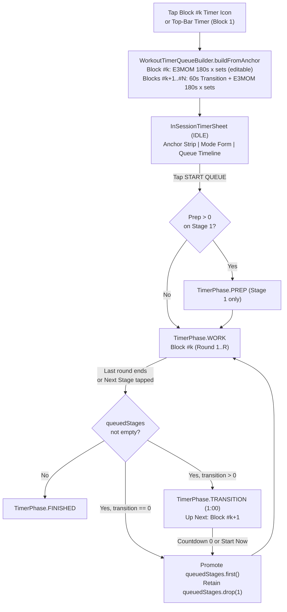

# Requirement Specification: Routine-Aware Auto-Extrapolated Workout Timer Queue

- **Status:** Draft Requirement (Approved Discovery — Ready for Refinement / Implementation Planning)
- **Created:** 2026-11-28
- **Target Repository:** `AntaresAndBharani/crosstrainingapp` (Android Jetpack Compose)
- **Design System & Governance References:**
  - [`design-system/crosstraining/MASTER.md`](file:///c:/Users/rogal/workspaces/ws-gym/crosstrainingapp/design-system/crosstraining/MASTER.md)
  - [`design-system/crosstraining/pages/routine-timer-queue.md`](file:///c:/Users/rogal/workspaces/ws-gym/crosstrainingapp/design-system/crosstraining/pages/routine-timer-queue.md)
  - [`.agents/rules/03_compose_ui_standards.md`](file:///c:/Users/rogal/workspaces/ws-gym/crosstrainingapp/.agents/rules/03_compose_ui_standards.md)
  - [`.specify/memory/constitution.md`](file:///c:/Users/rogal/workspaces/ws-gym/crosstrainingapp/.specify/memory/constitution.md)

---

## 1. Problem Statement & Current Codebase Gaps

When an athlete starts a daily training session in **Log Session** (either by loading a saved **Daily Routine** or creating blocks/exercises ad-hoc on the gym floor) and taps the timer, they expect the timer to understand the ordered blocks of their workout and automatically build a continuous queue from any selected block onward—applying `E3MOM` for the routine's default number of sets with a `1:00` transition between blocks.

Inspection of the current implementation reveals three concrete architectural and UX gaps:

1. **Single-Slot Queue Limit ([`WorkoutTimer.kt`](file:///c:/Users/rogal/workspaces/ws-gym/crosstrainingapp/app/src/main/java/com/fractanomics/crosstraining/ui/timer/WorkoutTimer.kt#L64-L90) & [`TimerEngine.kt`](file:///c:/Users/rogal/workspaces/ws-gym/crosstrainingapp/app/src/main/java/com/fractanomics/crosstraining/ui/timer/TimerEngine.kt)):**
   - `TimerSnapshot` only stores a single `queuedNextStage: QueuedTimerStage?`. Once Stage 1 finishes and Stage 2 is promoted, `queuedNextStage` becomes `null`. Multi-block routines (3–6+ blocks) cannot be queued end-to-end.
2. **Hardcoded `roundCount = 1` & No Sibling Block Awareness ([`SessionEditor.kt`](file:///c:/Users/rogal/workspaces/ws-gym/crosstrainingapp/app/src/main/java/com/fractanomics/crosstraining/ui/screens/SessionEditor.kt#L1569-L1572)):**
   - Tapping the timer icon on a `SimplifiedBlockLogCard` or `SimplifiedExerciseLogCard` invokes `launchTimingFromTokenOrOpenSheet(timingToken, 1, availState.block.title)`, ignoring the block's configured/default set count (`availState.complexSetCount`) and ignoring every subsequent block in `loadedAvailableBlocks` and legacy `blocks`.
3. **Top-Bar Timer Disconnects From Active Workout ([`SessionEditor.kt`](file:///c:/Users/rogal/workspaces/ws-gym/crosstrainingapp/app/src/main/java/com/fractanomics/crosstraining/ui/screens/SessionEditor.kt#L1390-L1394)):**
   - Tapping the Top-Bar Timer icon inside `Log Session` navigates away to standalone [`TimerScreen.kt`](file:///c:/Users/rogal/workspaces/ws-gym/crosstrainingapp/app/src/main/java/com/fractanomics/crosstraining/ui/screens/TimerScreen.kt) instead of opening [`InSessionTimerSheet.kt`](file:///c:/Users/rogal/workspaces/ws-gym/crosstrainingapp/app/src/main/java/com/fractanomics/crosstraining/ui/components/InSessionTimerSheet.kt) populated with the active session's blocks.

---

## 2. Locked Product & UX Decisions

| Decision Area | Locked Specification |
|---|---|
| **Starting Block Setup Rule** | Tapping a block `#k` opens `InSessionTimerSheet` pre-populated for Block `#k` with **`E3MOM` (`180s`) × `{sets}`** by default, while allowing the athlete to freely pick any of the 6 supported `TimerMode`s (`EMOM/ExMOM`, `Time Cap / For Time`, `AMRAP`, `Tabata / Intervals`, `Death By`, `Rest Timer`), duration, rounds, prep countdown, and alert preferences before starting. |
| **Remaining-Block Extrapolation Rule** | Every remaining block `#k+1 … #N` after the anchored starting block is **ALWAYS** auto-extrapolated as **`E3MOM` (`180s` interval) × `{sets}`**, **ignoring block notes, instructions, or embedded timing tokens**, and each remaining block is preceded by a **`1:00` (`60s`) `TimerPhase.TRANSITION`** countdown. |
| **Top-Bar Timer Behavior in `Log Session`** | When `>= 1` non-blank workout block/exercise is loaded in `Log Session`, tapping the Top-Bar Timer icon opens `InSessionTimerSheet` with a horizontal **Block Anchor Strip** defaulting to **Block 1** (or the currently active block if a timer is already running). When `0` workout blocks are present, it falls back to standalone `TimerScreen`. Drawer → `Workout Timers` always remains standalone `TimerScreen`. |
| **Per-Block Timer Icon Behavior** | Tapping the Timer icon on any block or exercise card `#k` opens `InSessionTimerSheet` anchored at Block `#k`, auto-extrapolating `#k+1 … #N`. (No silent bypass straight into execution without letting the athlete pick/confirm Block `#k`'s mode, e.g., `EMOM` vs `Time Cap`.) |
| **Queue Customization (Pre-Start & Live)** | The athlete can tap **any** auto-extrapolated stage in the queue (both before starting and while the timer is running/transitioning) to customize its `TimerMode`, duration/interval, round count, or preceding `transitionSeconds`, or remove a block from the queue (non-destructively to `Log Session`), or append extra stages. |
| **Set-Count Resolution Rule** | Default `{sets}` for each block is resolved deterministically from the block's routine/session state: `availState.complexSetCount` (initialized from `DailyRoutine` `targetSetsCount` → prior session sets → default tiles: `3` for blocks, `4` for standalone exercises, clamped `>= 1`) for simplified cards, and `item.totalRounds` / `block.sets.size` (`>= 1`) for legacy sub-blocks/cards. |
| **Prep Countdown Policy** | `prepCountdownSeconds` (e.g., `10s`) runs **only once** at the start of Stage 1 (the anchored starting block). Stages `2..N` automatically enter `WORK` directly upon completion of their `1:00` (`60s`) `TRANSITION` countdown with `prepCountdownSeconds = 0`. |
| **Database & Sync Impact** | **Zero Room SQLite schema migration** and **zero Firestore rule changes** — the timer queue is a pure runtime/UI orchestration layer derived from in-memory session blocks. |

---

## 3. Pure Domain Models, Extrapolation & Engine State Machine Specification

### 3.1 Session Block Descriptor (`SessionTimerBlockEntry`)
To decouple timer queue construction from Jetpack Compose state holders (`LoadedAvailableBlockState`, `EditorBlockItem`, `BlockState`), `Log Session` projects its ordered visible workout items into an immutable list of `SessionTimerBlockEntry`:

```kotlin
@Immutable
data class SessionTimerBlockEntry(
    val blockKey: String,          // Stable UI key (e.g., availState.uiKey or "legacy_<idx>")
    val positionIndex: Int,        // 0-based order in the current workout
    val title: String,             // Display name (block title, exercise name, or sub-block name)
    val defaultSetCount: Int       // Resolved routine/card set count, coerced >= 1
)
```

- **Unified Block Order:** `SessionEditorBody` builds `entries` in the exact top-to-bottom display order rendered on screen (`loadedAvailableBlocks` followed by any non-blank legacy `editorItems`, mapping `SubBlockGroup` as one entry with `item.totalRounds.coerceAtLeast(1)`).
- **Set Count Resolution (`resolveBlockDefaultSetCount`):**
  - Simplified Block / Standalone Exercise (`LoadedAvailableBlockState`): `availState.complexSetCount.coerceAtLeast(1)` (which already reflects routine `targetSetsCount`, historical session set count, or default empty tile count `3`/`4`).
  - Legacy `SubBlockGroup`: `group.totalRounds.coerceAtLeast(1)`.
  - Legacy `Standalone` `BlockState`: `block.sets.size.coerceAtLeast(1)`.

### 3.2 Pure Queue Builder (`WorkoutTimerQueueBuilder`)
Implemented as a pure, deterministic Kotlin object with zero Android framework dependencies:

```kotlin
data class BuiltWorkoutTimerQueue(
    val anchorIndex: Int,
    val startingConfig: WorkoutTimerConfig,
    val queuedStages: List<QueuedTimerStage>
)

object WorkoutTimerQueueBuilder {
    const val DEFAULT_EXMOM_INTERVAL_SECONDS = 180 // E3MOM
    const val DEFAULT_TRANSITION_SECONDS = 60      // 1:00 transition

    fun buildFromAnchor(
        entries: List<SessionTimerBlockEntry>,
        anchorIndex: Int,
        baseConfig: WorkoutTimerConfig
    ): BuiltWorkoutTimerQueue
}
```

**Deterministic Rules:**
1. Clamp `safeAnchor = anchorIndex.coerceIn(0, entries.lastIndex)` (for non-empty `entries`).
2. **Anchor Stage (`entries[safeAnchor]`):**
   - `mode = TimerMode.EMOM`
   - `intervalSeconds = DEFAULT_EXMOM_INTERVAL_SECONDS` (`180`)
   - `totalRounds = entry.defaultSetCount.coerceAtLeast(1)`
   - `workoutLabel = entry.title`
   - `sourceBlockKey = entry.blockKey`
   - Inherits `prepCountdownSeconds`, `soundEnabled`, and `vibrationEnabled` from `baseConfig`.
3. **Remaining Stages (`entries.drop(safeAnchor + 1)`):**
   - For every subsequent entry, regardless of block notes/instructions:
     - `config = WorkoutTimerConfig(mode = TimerMode.EMOM, intervalSeconds = 180, totalRounds = entry.defaultSetCount.coerceAtLeast(1), prepCountdownSeconds = 0, soundEnabled = baseConfig.soundEnabled, vibrationEnabled = baseConfig.vibrationEnabled, workoutLabel = entry.title, sourceBlockKey = entry.blockKey)`
     - `transitionSeconds = DEFAULT_TRANSITION_SECONDS` (`60`)
     - Stable unique `id` assigned per `QueuedTimerStage` for keyed Compose rendering and targeted editing/removal.
4. **Re-anchoring Helper:** When the user taps a different anchor pill `#m` in the pre-start setup sheet, `buildFromAnchor(entries, m, currentBaseConfig)` deterministically regenerates `startingConfig` and `queuedStages` from `#m`.

### 3.3 Multi-Stage `WorkoutTimerConfig`, `QueuedTimerStage` & `TimerSnapshot` Upgrades
Backward-compatible extensions to [`WorkoutTimer.kt`](file:///c:/Users/rogal/workspaces/ws-gym/crosstrainingapp/app/src/main/java/com/fractanomics/crosstraining/ui/timer/WorkoutTimer.kt):

- `WorkoutTimerConfig`:
  - Add `val sourceBlockKey: String? = null` to bind any running/queued stage back to its originating card in `Log Session`.
- `QueuedTimerStage`:
  - Add `val id: String = UUID.randomUUID().toString()` (unique per queued entry so repeated block names or edits retain identity).
- `TimerSnapshot`:
  - Replace single-slot backing state with immutable `val queuedStages: List<QueuedTimerStage> = emptyList()`.
  - Retain `val queuedNextStage: QueuedTimerStage? get() = queuedStages.firstOrNull()` as a computed property so existing UI/notification/test callers continue compiling and working seamlessly.
  - Retain `completedStagesCount: Int` so `"Block X of Y"` resolves directly as `currentIndex = completedStagesCount + 1` and `totalBlocks = completedStagesCount + 1 + queuedStages.size`.

### 3.4 Multi-Stage `TimerEngine` State Machine & API
Extend [`TimerEngine.kt`](file:///c:/Users/rogal/workspaces/ws-gym/crosstrainingapp/app/src/main/java/com/fractanomics/crosstraining/ui/timer/TimerEngine.kt):

- **Queue Configuration Methods:**
  - `configureQueue(newConfig: WorkoutTimerConfig, queuedStages: List<QueuedTimerStage> = emptyList())` (keep `configure(newConfig, queuedNext: QueuedTimerStage? = null)` delegating to `listOfNotNull(queuedNext)`).
  - `replaceTimerQueue(newConfig: WorkoutTimerConfig, queuedStages: List<QueuedTimerStage> = emptyList())` (atomic live replacement without transient `IDLE` flash).
  - `setQueuedStages(stages: List<QueuedTimerStage>)` (preserves `setQueuedNextStage(nextStage)` compatibility).
  - `updateQueuedStage(stageId: String, updated: QueuedTimerStage)`
  - `removeQueuedStage(stageId: String)`
  - `appendQueuedStage(stage: QueuedTimerStage)`
- **Stage Promotion Invariant:**
  - When Stage `i` finishes (either naturally at `roundSecondsRemaining <= 0` on final round or via `skipRound()`), if `queuedStages` is non-empty:
    - If `head.transitionSeconds > 0`, enter `TimerPhase.TRANSITION` for `head.transitionSeconds` while keeping `queuedStages` intact so `head` remains previewable and editable during the transition.
    - When `TRANSITION` completes (or immediately if `transitionSeconds == 0`), pop `head = queuedStages.first()`, promote `head.config` to active stage, retain `queuedStages.drop(1)` as the remaining queue, and increment `completedStagesCount`.
- **Mid-Transition Head Mutation Safety:**
  - If the athlete removes `head` (`queuedStages.first()`) while `phase == TimerPhase.TRANSITION`:
    - If a new stage becomes `firstOrNull()`, update the transition preview to the new head stage.
    - If `queuedStages` becomes empty, call `finishTimer()` immediately so `TRANSITION` never runs toward a `null` stage.
- **Deterministic Total Time Remaining:**
  - `calculateTotalSecondsRemaining` sums: active stage remaining + `queuedStages.sumOf { it.transitionSeconds.coerceAtLeast(0) + it.config.stageTotalSeconds() }` (excluding already-started transition wait when `phase == TRANSITION`, i.e., `roundSecondsRemaining + head.config.stageTotalSeconds() + queuedStages.drop(1).sumOf { it.transitionSeconds.coerceAtLeast(0) + it.config.stageTotalSeconds() }`).



---

## 4. User Stories & Acceptance Criteria

### US-1: Deterministic Multi-Block Queue Extrapolation & Engine Execution
**As an** athlete starting a multi-block workout in `Log Session`,
**I want** the timer engine to extrapolate all remaining blocks as `E3MOM` for their routine-defined sets separated by `1:00` transitions and execute them continuously in sequence,
**So that** my entire gym session runs hands-free without reconfiguring the timer between exercises.

**Acceptance Criteria:**
- **Given** a loaded routine or session with 4 blocks (`[A: 4 sets, B: 3 sets, C: 5 sets, D: 2 sets]`), **When** `WorkoutTimerQueueBuilder.buildFromAnchor` is invoked at anchor index `1` (`B`), **Then**:
  - `startingConfig` defaults to `EMOM` `180s` (`E3MOM`) × `3` rounds labeled `B` with `sourceBlockKey` for `B`.
  - `queuedStages` contains exactly 2 stages: `[60s transition → C (E3MOM 180s × 5), 60s transition → D (E3MOM 180s × 2)]`.
  - Block `A` (prior to anchor `1`) is excluded from the queue.
- **Given** Block `C` has `"AMRAP 12"` or `"Rest 90s"` in its instructions/notes, **When** `WorkoutTimerQueueBuilder` builds remaining stages `C` and `D`, **Then** it ignores the notes/instructions and assigns `E3MOM (180s) × {sets}` with a `60s` transition.
- **Given** a multi-stage queue is running and Stage 1 completes, **When** `TimerPhase.TRANSITION` counts down to `0`, **Then** Stage 2 promotes automatically with `prepCountdownSeconds = 0`, `completedStagesCount` increments by `1`, and Stages `3..N` remain queued in `TimerSnapshot.queuedStages`.

---

### US-2: Launching & Anchoring the Queue from Any Block or Top-Bar Timer
**As an** athlete inside `Log Session`,
**I want** to tap any block/exercise's Timer icon—or the Top-Bar Timer icon—to open the queue anchored at that block and pick its starting mode (e.g., `EMOM`, `Time Cap`, `AMRAP`),
**So that** I can start from any block in my daily routine and customize its timer format before pressing Start.

**Acceptance Criteria:**
- **Given** `Log Session` has 3 blocks (`Back Squat`, `Clean Complex`, `Row Intervals`), **When** the athlete taps the Timer icon on Block 2 (`Clean Complex`), **Then**:
  - `InSessionTimerSheet` opens in setup mode (`IDLE`) with Block 2 selected in the **Block Anchor Strip**, Block 2's configurator pre-filled as `E3MOM × {sets}` (freely switchable to `Time Cap`, `AMRAP`, `EMOM`, `Tabata`, `Death By`, `Rest`), and Block 3 queued after a `1:00` transition.
- **Given** the athlete switches the starting block mode from `E3MOM` to `Time Cap 12 min` and taps `START QUEUE`, **Then** Stage 1 runs as `12:00 Time Cap` and upon completion (or tapping `Next Stage` when finished early) enters the `1:00` transition into Block 3 (`E3MOM × {sets}`).
- **Given** `Log Session` has `>= 1` workout block/exercise and no timer is currently active, **When** the athlete taps the Top-Bar Timer icon, **Then** `InSessionTimerSheet` opens anchored at **Block 1** with all blocks `2..N` auto-extrapolated.
- **Given** `Log Session` has `0` workout blocks/exercises (blank session), **When** the athlete taps the Top-Bar Timer icon, **Then** navigation opens standalone `TimerScreen` as before.

---

### US-3: Pre-Start & Live Customization of Any Queued Block & Transition
**As an** athlete adapting my workout on the fly,
**I want** to inspect, edit, or remove any queued upcoming block or its transition time—both before starting and while a timer is running,
**So that** I can adjust intervals, change a later block to `AMRAP`, shorten a transition, or drop a block without restarting from scratch.

**Acceptance Criteria:**
- **Given** the pre-start setup timeline or the active timer sheet (`Remaining Queue`), **When** the athlete taps **Edit** on any queued block `#j`, **Then** `NextModeConfigSheet` opens pre-populated with `#j`'s current `WorkoutTimerConfig` and `transitionSeconds`, and saving updates only stage `#j` in place while preserving all other queued stages and recalculating total remaining time.
- **Given** any queued stage `#j` in pre-start or active execution, **When** the athlete taps **Remove**, **Then** stage `#j` is removed from the timer queue without modifying or removing the block card in `Log Session`.
- **Given** `TimerPhase.TRANSITION` is active and the athlete removes the immediate next stage `#head`, **When** other stages follow in `queuedStages`, **Then** the transition updates its Up Next target to the new head stage; if no stages remain, the timer transitions cleanly to `FINISHED`.
- **Given** the athlete taps `+ Add Stage`, **Then** a new custom stage can be appended to the end of `queuedStages`.

---

### US-4: In-Session Context Sync (`InSessionTimerBar`, Active Card Highlight & Notifications)
**As an** athlete logging weights and reps while my routine timer runs,
**I want** the docked bar, active workout card, and lock-screen notification to show which block is currently timed without stealing my keyboard focus,
**So that** I never lose track of my current block or interrupt typing sets.

**Acceptance Criteria:**
- **Given** a queue timer is running for Block 2 of 4 (`Clean Complex`), **When** the athlete collapses `InSessionTimerSheet` to log weights in `Log Session`, **Then**:
  - `InSessionTimerBar` displays phase, `tnum` clock, `Clean Complex`, round info, and queue position (`2/4`), and tapping its controls never steals keyboard focus (`focusProperties { canFocus = false }`).
  - The matching `Clean Complex` card in `Log Session` displays a subtle active border accent and a compact `"Timer Active"` pill.
  - `TimerService` notification displays block context (`Clean Complex - Round X/Y`, or `Transition - Up Next: <NextBlockTitle>` during transitions).
- **Given** a phase, round, or stage boundary occurs while TalkBack is active, **When** `LiveRegionMode.Polite` emits an announcement, **Then** it announces the block title and queue position at the boundary only (zero per-second announcements).

---

### US-5: Safe Conflict Resolution, Reset Semantics & Standalone Parity
**As an** athlete interacting with multiple cards while a timer is already running,
**I want** predictable behavior when tapping the active block vs. a different block vs. resetting,
**So that** I never accidentally wipe an active multi-block queue.

**Acceptance Criteria:**
- **Given** a timer is actively running for Block `#k`, **When** the athlete taps the Timer icon on that same Block `#k` (or taps the Top-Bar Timer icon), **Then** `InSessionTimerSheet` opens directly to the running timer (no conflict dialog).
- **Given** a timer is actively running for Block `#k`, **When** the athlete taps the Timer icon on a different Block `#m`, **Then** a confirmation dialog asks **"Replace timer & start queue from `<Block m>`?"** (`Rebuild Queue` vs `Cancel`); confirming atomically replaces the active timer and queue via `replaceTimerQueue` anchored at `#m`.
- **Given** a multi-stage queue is running or transitioning and the athlete taps **Reset**, **Then** `ResetTimerConfirmDialog` offers **"Restart Current Block (Keep Queue)"** vs **"Stop & Clear Full Queue"** vs **"Cancel"**.
- **Given** the athlete opens standalone `TimerScreen` from the navigation drawer, **Then** existing 6-mode setup, single-or-multi stage queueing, and presets continue to work cleanly with no regressions.

---

## 5. UI/UX, Design System & Accessibility Requirements

All UI implementation MUST comply with [`MASTER.md`](file:///c:/Users/rogal/workspaces/ws-gym/crosstrainingapp/design-system/crosstraining/MASTER.md) and [`pages/routine-timer-queue.md`](file:///c:/Users/rogal/workspaces/ws-gym/crosstrainingapp/design-system/crosstraining/pages/routine-timer-queue.md):

1. **Theming & Contrast:** Use `MaterialTheme.colorScheme.*` and `Color.kt` Ochre transition tokens exclusively across all 4 `AppThemeMode`s (`DARK`, `LIGHT`, `DARK_HIGH_CONTRAST`, `LIGHT_HIGH_CONTRAST`) via `isAppDarkTheme()`.
2. **Touch Targets & Gym Ergonomics:** Enforce `>= 48.dp x 48.dp` touch targets and `>= 8.dp` spacing on every anchor chip, Edit/Remove icon button, stepper control, and transport pill.
3. **Tabular Numerals & Vector Icons:** Apply `fontFeatureSettings = "tnum"` on all clocks, queue durations, and round counters. Use Material vector icons only (no structural emojis).
4. **360dp & Dynamic Type Reflow:** Guarantee zero clipping, overlap, or wrapped transport pill text on `360dp` phones up to `fontScale = 1.3f` (graceful reflow up to `2.0f`).
5. **Accessibility & Performance:** Use `@Immutable` UI projection state, stable `key = stage.id` in queue lists, `rememberSaveable` for queue drawer expansion, `Modifier.semantics(mergeDescendants = true)` on queue rows, and boundary-only `LiveRegionMode.Polite` announcements.

---

## 6. Architectural Impact Map (Reference Only — Zero Schema Migration)

| Layer / File | Expected Responsibility |
|---|---|
| `app/.../ui/timer/WorkoutTimer.kt` | Add `sourceBlockKey: String?` on `WorkoutTimerConfig`, `id: String` on `QueuedTimerStage`, immutable `queuedStages: List<QueuedTimerStage>` on `TimerSnapshot` with backward-compatible computed `queuedNextStage`. |
| `app/.../ui/timer/WorkoutTimerQueueBuilder.kt` *(New)* | Pure `SessionTimerBlockEntry` model and deterministic `WorkoutTimerQueueBuilder.buildFromAnchor(...)` enforcing `E3MOM (180s) × sets` and `60s` transitions. |
| `app/.../ui/timer/TimerEngine.kt` | Multi-stage queue storage, `configureQueue` / `replaceTimerQueue` / `setQueuedStages` / `updateQueuedStage` / `removeQueuedStage` / `appendQueuedStage`, head-popping promotion, mid-transition removal guard, and full-queue `calculateTotalSecondsRemaining`. |
| `app/.../ui/timer/ContinuousTimerUiResolver.kt` | Block position formatting (`Block X of Y • <Title>`), queue total duration formatting, `InSessionTimerBar` summary text, and block-aware TalkBack boundary announcements. |
| `app/.../ui/timer/TimerNotificationFormatter.kt` | Include block/workout label alongside phase/round and Up Next block title in foreground notifications. |
| `app/.../ui/components/ContinuousTimerComponents.kt` | Add `QueueTimelinePreview` (with Ochre `1:00 Transition` connectors), upgrade `UpNextQueueCard` to expandable multi-stage `TimerQueueSection` (`key = stage.id`), and show `Block X of Y • <Title>` header in `ActiveContinuousTimerCard`. |
| `app/.../ui/components/InSessionTimerSheet.kt` | Accept ordered `sessionBlocks: List<SessionTimerBlockEntry>` & `initialAnchorIndex`, host the **Block Anchor Strip**, initialize starting block + extrapolated queue, and wire pre-start/live queue editing and `START QUEUE` launch. |
| `app/.../ui/components/InSessionTimerBar.kt` | Display active block name + queue position (`1/4`) and transition Up Next block label while preserving `focusProperties { canFocus = false }`. |
| `app/.../ui/screens/SessionEditor.kt` | Derive ordered `SessionTimerBlockEntry` list from `loadedAvailableBlocks` and non-blank legacy `blocks/subBlocks`; route Top-Bar Timer (when blocks exist) and per-block Timer taps to `InSessionTimerSheet` anchored at the selected block; pass `isTimerActiveForCard` to cards; show Rebuild-Queue conflict dialog when switching blocks mid-run. |
| `app/.../ui/screens/SimplifiedBlockLogComponents.kt` | Render subtle `"Timer Active"` badge and active border accent on `SimplifiedBlockLogCard` / `SimplifiedExerciseLogCard` when matched to the running timer's `sourceBlockKey`. |
| `app/.../ui/screens/TimerScreen.kt` | Remain backward compatible for standalone drawer usage, optionally benefitting from multi-stage `+ Add Stage` queue management. |

---

## 7. Edge Cases & Guardrails

| Edge Case | Required Behavior |
|---|---|
| **Anchored on the final block (`#N`)** | `queuedStages` is empty; CTA reads `START TIMER` (1 block), no trailing `1:00` transition is added after the last block, and finishing enters `TimerPhase.FINISHED`. |
| **Empty `Log Session` (`0` blocks/exercises)** | Top-Bar Timer icon routes to standalone `TimerScreen` as before. |
| **Block with 1 set (`targetSetsCount = 1`)** | Starting and extrapolated `E3MOM` configs clamp `totalRounds >= 1` (`1 × 180s`). |
| **Ad-hoc block with no routine/history** | Uses the card's current visible set count (`complexSetCount` = `3` default tiles for blocks, `4` for standalone exercises, or user-added/removed set count). |
| **Finishing a `TIME_CAP` block early** | Tapping `Next Stage` immediately completes the `TIME_CAP` block and starts the `1:00` (`60s`) `TimerPhase.TRANSITION` countdown into the next queued block. |
| **Removing the head stage during `TRANSITION`** | If another stage follows in `queuedStages`, `TRANSITION` updates its preview to the new head stage; if no stages remain, `TimerEngine` transitions cleanly to `TimerPhase.FINISHED`. |
| **Removing a block card from `Log Session` while its timer runs** | Timer continues uninterrupted without crashing; the missing card simply has no highlight in `Log Session`. |
| **Tapping Timer on the already-active block** | Opens `InSessionTimerSheet` to inspect/control the active timer (no replacement confirmation dialog). |
| **Tapping Timer on a different block while running** | Prompts **"Replace timer & start queue from `<Block m>`?"** (`Rebuild Queue` / `Cancel`); confirming calls `replaceTimerQueue` without emitting a transient `IDLE` state. |
| **Tapping `Reset` during a queued session** | `ResetTimerConfirmDialog` preserves the choice between **"Restart Current Block (Keep Queue)"** and **"Stop & Clear Full Queue"**. |
| **Repeated block/exercise names in a routine** | Each `SessionTimerBlockEntry` and `QueuedTimerStage` is keyed by unique `blockKey` / `stage.id`, never colliding on duplicate display titles. |

---

## 8. Out of Scope

- Any Room SQLite schema migration or Cloud Firestore security-rule / collection changes.
- Persisting per-block timer configurations back into `DailyRoutine` / `AvailableBlock` templates (future enhancement).
- Automatically populating or marking logged sets/reps/weights from timer round completions.
- Drag-and-drop queue reordering inside `ModalBottomSheet` in v1 (to avoid vertical scroll vs. drag gesture conflicts; athletes re-anchor or edit/remove stages via accessible `48.dp` tap controls).

---

## 9. Verification & Definition of Done (for Future Implementation)

1. **Android JVM Unit Tests (`.\gradlew.bat testDebugUnitTest --no-daemon`):**
   - `WorkoutTimerQueueBuilderTest`: anchor at first/middle/last block, `E3MOM 180s × sets` enforcement even when notes contain `"AMRAP 12"` / `"Rest 90s"`, `60s` transitions, prep-only-on-Stage-1, set count clamps, unique stage IDs.
   - `TimerEngineTest`: multi-stage (`3+` stages) automatic progression across `WORK → TRANSITION → WORK`, `skipRound()` / early `TIME_CAP` finish into `TRANSITION`, `updateQueuedStage` / `removeQueuedStage` (including removing head during `TRANSITION`), `appendQueuedStage`, `replaceTimerQueue`, `restartCurrentStage` preserving queue, and exact `calculateTotalSecondsRemaining` sums.
   - `ContinuousTimerUiResolverTest` & `TimerNotificationFormatterTest`: `Block X of Y • <Title>` formatting, transition labels, and block-aware TalkBack boundary announcements.
2. **Android Lint & Script Regression Tests:**
   - `.\gradlew.bat lintDebug --no-daemon` passes with 0 errors.
   - `.\scripts\tests\Invoke-ScriptTests.ps1` passes at 100%.
3. **Pre-Delivery UI Audit:**
   - Verified against [`MASTER.md`](file:///c:/Users/rogal/workspaces/ws-gym/crosstrainingapp/design-system/crosstraining/MASTER.md) and [`pages/routine-timer-queue.md`](file:///c:/Users/rogal/workspaces/ws-gym/crosstrainingapp/design-system/crosstraining/pages/routine-timer-queue.md) across all 4 `AppThemeMode`s, `360dp` viewports, `fontScale >= 1.3f`, and keyboard focus preservation in `Log Session`.
4. **Changelog & Remote CI:**
   - `CHANGELOG.md` updated under `## [Unreleased]` during implementation PR and all GitHub Actions CI checks 100% green prior to merge.
