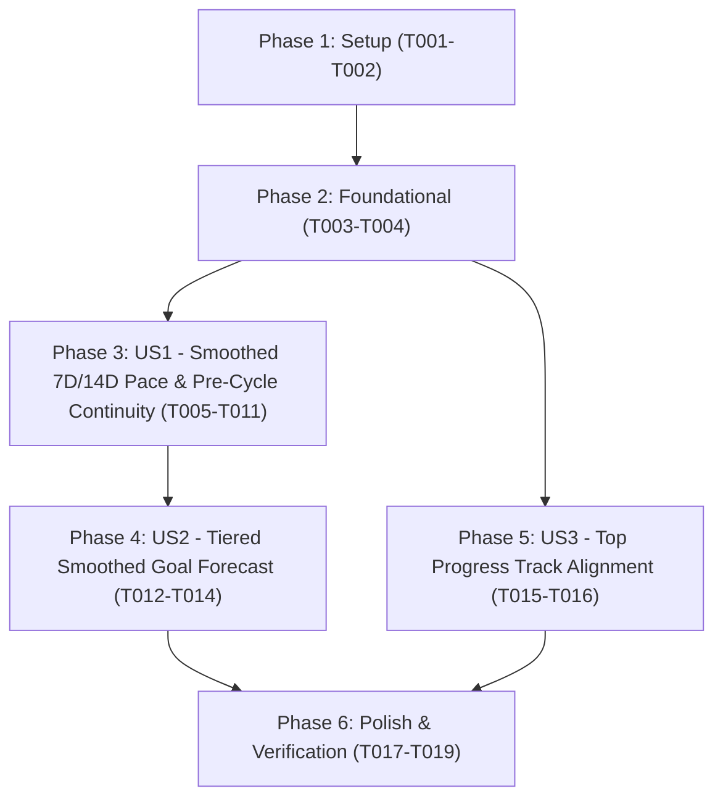

# Tasks: Rolling Window Average Pacing & Goal Forecast Alignment

**Input**: Design documents from `/specs/001-rolling-weight-pace/`
**Prerequisites**: [plan.md](file:///c:/Users/rogal/workspaces/ws-gym/crosstrainingapp/specs/001-rolling-weight-pace/plan.md) (required), [spec.md](file:///c:/Users/rogal/workspaces/ws-gym/crosstrainingapp/specs/001-rolling-weight-pace/spec.md) (required for user stories), [research.md](file:///c:/Users/rogal/workspaces/ws-gym/crosstrainingapp/specs/001-rolling-weight-pace/research.md), [data-model.md](file:///c:/Users/rogal/workspaces/ws-gym/crosstrainingapp/specs/001-rolling-weight-pace/data-model.md), [contracts/analytics-contract.md](file:///c:/Users/rogal/workspaces/ws-gym/crosstrainingapp/specs/001-rolling-weight-pace/contracts/analytics-contract.md), [quickstart.md](file:///c:/Users/rogal/workspaces/ws-gym/crosstrainingapp/specs/001-rolling-weight-pace/quickstart.md)

**Tests**: Unit test tasks are included to enforce the project's Testing & CI Parity guideline (`GEMINI.md` Guideline 3) and validate all acceptance scenarios in `spec.md`.

**Organization**: Tasks are grouped by user story (`US1`, `US2`, `US3`) to enable independent implementation, verification, and incremental delivery.

## Format: `[ID] [P?] [Story] Description`

- **[P]**: Can run in parallel (different files, no blocking dependencies)
- **[Story]**: Which user story this task belongs to (`[US1]`, `[US2]`, `[US3]`)
- Exact file paths are included in all task descriptions

---

## Phase 1: Setup (Shared Infrastructure)

**Purpose**: Synchronize branch state with the latest `origin/main` / `feat/issue-604` baseline so that `computeRollingWeightHero`, `computePaceComparisonVsLastWeek`, `computeSameDayWeightTrio`, and the 3-pillar `WeightProgressionHeroCard` are present in the working tree before applying changes.

- [X] T001 Align the active feature branch with the latest baseline containing `computeRollingWeightHero` and `WeightProgressionHeroCard` in `app/src/main/java/com/fractanomics/crosstraining/data/analytics/FatLossAnalytics.kt` and `app/src/main/java/com/fractanomics/crosstraining/ui/screens/ProgressScreen.kt`
- [X] T002 Verify clean baseline compilation and unit test execution for `FatLossAnalyticsTest` in `app/src/test/java/com/fractanomics/crosstraining/data/analytics/FatLossAnalyticsTest.kt`

---

## Phase 2: Foundational (Blocking Prerequisites)

**Purpose**: Shared 7-day rolling window average lookback resolution and pre-cycle weight entry filtering helpers in `FatLossAnalytics.kt` required by all three user stories.

**⚠️ CRITICAL**: No user story work can begin until this phase is complete.

- [X] T003 Implement shared in-cycle gate and historical entry pool filtering (`deletedAtMillis == null && !date.isAfter(referenceDate)`) plus 7-day window average helper in `app/src/main/java/com/fractanomics/crosstraining/data/analytics/FatLossAnalytics.kt`
- [X] T004 Update `computeCurrent7DayAverageWeight` to include non-deleted pre-cycle entries in the `[anchorDate - 6d, anchorDate]` window when at least one in-cycle entry exists in `app/src/main/java/com/fractanomics/crosstraining/data/analytics/FatLossAnalytics.kt`

**Checkpoint**: Shared rolling-window and pre-cycle lookback helpers are ready — User Story implementation can now proceed.

---

## Phase 3: User Story 1 - Smoothed 7-Day and 14-Day Pace Rates with Pre-Cycle Continuity (Priority: P1) 🎯 MVP

**Goal**: Compute 7-Day Pace, 14-Day Pace, 3-pillar hero lookback averages (`LAST WEEK`, `14D AVG`), and week-over-week pace comparison subtitles from 7-day rolling window averages (including pre-cycle weight entries and `startingWeightKg` fallback) rather than single-day raw weigh-ins.

**Independent Test**: Run `.\gradlew.bat testDebugUnitTest --tests "com.fractanomics.crosstraining.data.analytics.FatLossAnalyticsTest" --no-daemon` to verify that 3 weeks of weigh-ins with a single-day outlier 14 days ago produce smoothed 7-Day Pace (`Today 7D Avg - Last Week 7D Avg`) and 14-Day Pace (`(Today 7D Avg - 2WksAgo 7D Avg) / 2.0`), pre-cycle lookback entries populate `computeRollingWeightHero` and `compute14DayPace`, and `computePaceComparisonVsLastWeek` compares smoothed paces.

### Tests for User Story 1

- [X] T005 [P] [US1] Add and update unit tests for pre-cycle lookback continuity in `computeRollingWeightHero` in `app/src/test/java/com/fractanomics/crosstraining/data/analytics/FatLossAnalyticsTest.kt`
- [X] T006 [P] [US1] Add and update unit tests for smoothed 7-day and 14-day window average pace calculations (`compute7DayPace`, `compute14DayPace`, `computePaceRate`) including single-day outlier resistance and `startingWeightKg` fallback in `app/src/test/java/com/fractanomics/crosstraining/data/analytics/FatLossAnalyticsTest.kt`
- [X] T007 [P] [US1] Add and update unit tests for smoothed week-over-week pace comparison (`computePaceComparisonVsLastWeek`) in `app/src/test/java/com/fractanomics/crosstraining/data/analytics/FatLossAnalyticsTest.kt`

### Implementation for User Story 1

- [X] T008 [US1] Update `computeRollingWeightHero` to require at least one in-cycle weigh-in (`date in [cycleStartDate, referenceDate]`) while computing `[t-6, t]`, `[t-13, t-7]`, `[t-13, t]`, and `[t-20, t-7]` window averages across all non-deleted entries (including pre-cycle entries) in `app/src/main/java/com/fractanomics/crosstraining/data/analytics/FatLossAnalytics.kt`
- [X] T009 [US1] Refactor `computePaceRate`, `compute7DayPace`, and `compute14DayPace` to compute weekly rate from 7-day rolling window averages (`currentAvgKg` over `[t-6, t]` vs `priorAvgKg` over `[t-windowDays-6, t-windowDays]`) with sparse-history and `startingWeightKg` fallback in `app/src/main/java/com/fractanomics/crosstraining/data/analytics/FatLossAnalytics.kt`
- [X] T010 [US1] Refactor `computePaceComparisonVsLastWeek` to evaluate current and lagged (`t - 7d`) smoothed pace rates via `computePaceRate` (accepting optional `startingWeightKg`) in `app/src/main/java/com/fractanomics/crosstraining/data/analytics/FatLossAnalytics.kt`
- [X] T011 [US1] Wire `cycle.startingWeightKg` into `compute7DayPace`, `compute14DayPace`, and `computePaceComparisonVsLastWeek` inside `WeightProgressionCard` in `app/src/main/java/com/fractanomics/crosstraining/ui/screens/ProgressScreen.kt`

**Checkpoint**: User Story 1 is complete and independently verifiable via `FatLossAnalyticsTest`.

---

## Phase 4: User Story 2 - Accurate Goal Forecast Driven by Tiered Smoothed Pace (Priority: P1)

**Goal**: Drive the "Estimated: X.X weeks" and projected arrival date forecast using remaining smoothed weight (`Today 7D Avg - Target Weight`) divided by a 3-tier smoothed deficit velocity hierarchy (Tier 1: 14-Day Smoothed Pace -> Tier 2: 7-Day Smoothed Pace -> Tier 3: Overall Cycle Pace -> `Stalled`).

**Independent Test**: Run `.\gradlew.bat testDebugUnitTest --tests "com.fractanomics.crosstraining.data.analytics.FatLossAnalyticsTest" --tests "com.fractanomics.crosstraining.ui.screens.WeightProgressionCardTest" --no-daemon` to verify that a `72.0 kg` goal with `75.7 kg` 7D average (`3.7 kg` remaining) and `-0.4 kg/wk` 14D smoothed pace projects `9.3 weeks`, and cleanly falls back to Tier 2 (`7D Smoothed Pace`) and Tier 3 (`Overall Cycle Pace`) when earlier tiers are unavailable or stalled.

### Tests for User Story 2

- [X] T012 [P] [US2] Add unit tests for `computePaceForecast` 3-tier velocity resolution (Tier 1 14D smoothed pace, Tier 2 7D smoothed pace fallback, Tier 3 overall cycle pace fallback, and all-tiers-stalled behavior) in `app/src/test/java/com/fractanomics/crosstraining/data/analytics/FatLossAnalyticsTest.kt`
- [X] T013 [P] [US2] Update forecast projection assertions in `app/src/test/java/com/fractanomics/crosstraining/ui/screens/WeightProgressionCardTest.kt`

### Implementation for User Story 2

- [X] T014 [US2] Refactor `computePaceForecast` to resolve active deficit velocity using the 3-tier smoothed priority hierarchy (`v14` -> `v7` -> `vCycle`) and pre-cycle span checks while preserving `GoalReached > CycleEnded > NotEnoughData > Stalled > Projected` precedence in `app/src/main/java/com/fractanomics/crosstraining/data/analytics/FatLossAnalytics.kt`

**Checkpoint**: User Stories 1 and 2 are both complete and independently passing all domain and screen unit tests.

---

## Phase 5: User Story 3 - Cohesive Top Progress Track & Remaining Goal Distance (Priority: P2)

**Goal**: Align the `WeightProgressionHeroCard` top reference track (`% to goal` and `GOAL (-X.X kg left)`) to use `resolvedToday7dAvgKg` instead of raw single-day `currentWeightKg`, ensuring `START`, `TODAY`, `GOAL (-X.X kg left)`, `% to goal`, and `Estimated: X.X weeks` all reconcile mathematically on screen.

**Independent Test**: Run `.\gradlew.bat testDebugUnitTest --tests "com.fractanomics.crosstraining.ui.screens.WeightProgressionCardTest" --no-daemon` to verify that when `START = 77.8 kg`, `GOAL = 72.0 kg`, raw weight is `74.7 kg`, and `TODAY` 7D average is `75.7 kg`, the card computes `-3.7 kg left` and `36.2% to goal`.

### Tests for User Story 3

- [X] T015 [P] [US3] Add and update top reference track completion percentage and remaining goal weight assertions using `resolvedToday7dAvgKg` in `app/src/test/java/com/fractanomics/crosstraining/ui/screens/WeightProgressionCardTest.kt`

### Implementation for User Story 3

- [X] T016 [US3] Update `progressFraction`, `isGoalReached`, and `remainingKg` in `WeightProgressionHeroCard` to use `resolvedToday7dAvgKg` instead of `currentWeightKg` in `app/src/main/java/com/fractanomics/crosstraining/ui/screens/ProgressScreen.kt`

**Checkpoint**: All user stories (`US1`, `US2`, `US3`) are implemented and independently verified.

---

## Phase 6: Polish & Cross-Cutting Concerns

**Purpose**: Full regression suite validation, script tests, and local APK build/sync per `GEMINI.md`.

- [X] T017 Execute the full Android unit test suite (`.\gradlew.bat testDebugUnitTest --no-daemon`) across `app/src/test/java/com/fractanomics/crosstraining/data/analytics/FatLossAnalyticsTest.kt` and `app/src/test/java/com/fractanomics/crosstraining/ui/screens/WeightProgressionCardTest.kt`
- [X] T018 [P] Execute the PowerShell script regression test suite in `scripts/tests/Invoke-ScriptTests.ps1`
- [X] T019 Assemble the debug APK (`.\gradlew.bat assembleDebug --no-daemon`) and copy the output artifact to `local_test/latest.apk`

---

## Dependencies & Execution Order

### Phase Dependencies

- **Phase 1: Setup (`T001`–`T002`)**: No dependencies — must complete first to ensure the workspace has the latest `WeightProgressionHeroCard` and `FatLossAnalytics` baseline.
- **Phase 2: Foundational (`T003`–`T004`)**: Depends on Phase 1 — establishes the shared 7-day rolling window average and pre-cycle lookback helpers in `FatLossAnalytics.kt`. Blocks all user stories.
- **Phase 3: User Story 1 (`T005`–`T011`, P1 🎯 MVP)**: Depends on Phase 2 — implements smoothed 7D/14D pace rates, pre-cycle continuity in `computeRollingWeightHero`, and smoothed pace comparisons.
- **Phase 4: User Story 2 (`T012`–`T014`, P1)**: Depends on Phase 2 and User Story 1 (`T009` smoothed `compute14DayPace`/`compute7DayPace` used as Tiers 1 & 2 in `computePaceForecast`).
- **Phase 5: User Story 3 (`T015`–`T016`, P2)**: Depends on Phase 2 — updates `WeightProgressionHeroCard` in `ProgressScreen.kt` and can run in parallel with Phase 4 (`US2`).
- **Phase 6: Polish (`T017`–`T019`)**: Depends on completion of Phases 3, 4, and 5.

### User Story Dependencies



### Parallel Opportunities

- **Within User Story 1**: Test tasks `T005`, `T006`, and `T007` can be drafted in parallel before implementing `T008`–`T011`.
- **Within User Story 2**: Test tasks `T012` (`FatLossAnalyticsTest.kt`) and `T013` (`WeightProgressionCardTest.kt`) touch different files and can be executed in parallel.
- **Cross-Story Parallelism**: User Story 3 (`T015`–`T016` in `ProgressScreen.kt` and `WeightProgressionCardTest.kt`) has no dependency on User Story 2 (`T014` in `FatLossAnalytics.kt`) and can be implemented in parallel once Phase 2 is complete.

---

## Parallel Example: User Story 2 & User Story 3

```bash
# Run domain forecast tests (US2) and UI card track tests (US3) in parallel across separate test files:
Task T012: "Add unit tests for computePaceForecast 3-tier velocity resolution in app/src/test/java/com/fractanomics/crosstraining/data/analytics/FatLossAnalyticsTest.kt"
Task T015: "Add and update top reference track completion percentage and remaining goal weight assertions in app/src/test/java/com/fractanomics/crosstraining/ui/screens/WeightProgressionCardTest.kt"

# Implement domain forecast logic (US2) and UI top reference track alignment (US3) in parallel across separate production files:
Task T014: "Refactor computePaceForecast in app/src/main/java/com/fractanomics/crosstraining/data/analytics/FatLossAnalytics.kt"
Task T016: "Update progressFraction, isGoalReached, and remainingKg in WeightProgressionHeroCard in app/src/main/java/com/fractanomics/crosstraining/ui/screens/ProgressScreen.kt"
```

---

## Implementation Strategy

### MVP First (User Story 1 + User Story 2)

1. Complete **Phase 1: Setup** (`T001`–`T002`) and **Phase 2: Foundational** (`T003`–`T004`).
2. Complete **Phase 3: User Story 1** (`T005`–`T011`) to deliver smoothed 7-Day and 14-Day Pace rates and pre-cycle lookback continuity.
3. Complete **Phase 4: User Story 2** (`T012`–`T014`) so the Goal Forecast immediately uses the smoothed 14D/7D/Cycle deficit velocity hierarchy and eliminates the 36.6-week spike.
4. **Validate**: Run `FatLossAnalyticsTest` and `WeightProgressionCardTest`.

### Full Delivery

5. Complete **Phase 5: User Story 3** (`T015`–`T016`) to align the top reference track (`% to goal` and `-X.X kg left`) with `resolvedToday7dAvgKg`.
6. Complete **Phase 6: Polish & Verification** (`T017`–`T019`) to verify 100% green unit/script tests and sync `local_test/latest.apk`.
