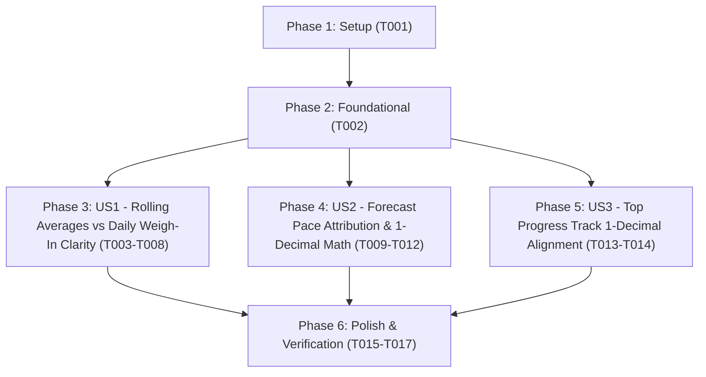

# Tasks: Weight Progression Table Clarity & Forecast Pace Attribution

**Input**: Design documents from `/specs/002-weight-card-clarity-and-forecast-pace/`
**Prerequisites**: [plan.md](file:///c:/Users/rogal/workspaces/ws-gym/crosstrainingapp/specs/002-weight-card-clarity-and-forecast-pace/plan.md) (required), [spec.md](file:///c:/Users/rogal/workspaces/ws-gym/crosstrainingapp/specs/002-weight-card-clarity-and-forecast-pace/spec.md) (required for user stories), [research.md](file:///c:/Users/rogal/workspaces/ws-gym/crosstrainingapp/specs/002-weight-card-clarity-and-forecast-pace/research.md), [data-model.md](file:///c:/Users/rogal/workspaces/ws-gym/crosstrainingapp/specs/002-weight-card-clarity-and-forecast-pace/data-model.md), [contracts/analytics-contract.md](file:///c:/Users/rogal/workspaces/ws-gym/crosstrainingapp/specs/002-weight-card-clarity-and-forecast-pace/contracts/analytics-contract.md), [quickstart.md](file:///c:/Users/rogal/workspaces/ws-gym/crosstrainingapp/specs/002-weight-card-clarity-and-forecast-pace/quickstart.md)

**Tests**: Unit and Compose UI test tasks are included to enforce the project's Testing & CI Parity guideline (`GEMINI.md` Guideline 3) and validate all acceptance scenarios in `spec.md`.

**Organization**: Tasks are grouped by user story (`US1`, `US2`, `US3`) to enable independent implementation, verification, and incremental delivery.

## Format: `[ID] [P?] [Story] Description`

- **[P]**: Can run in parallel (different files, no blocking dependencies)
- **[Story]**: Which user story this task belongs to (`[US1]`, `[US2]`, `[US3]`)
- Exact file paths are included in all task descriptions

---

## Phase 1: Setup (Shared Infrastructure)

**Purpose**: Verify the workspace baseline and ensure clean compilation of `FatLossAnalytics.kt` and `ProgressScreen.kt` before applying feature changes.

- [x] T001 Verify clean baseline compilation and unit test execution for `FatLossAnalyticsTest` and `WeightProgressionCardTest` in `app/src/test/java/com/fractanomics/crosstraining/data/analytics/FatLossAnalyticsTest.kt` and `app/src/test/java/com/fractanomics/crosstraining/ui/screens/WeightProgressionCardTest.kt`

---

## Phase 2: Foundational (Blocking Prerequisites)

**Purpose**: Shared 1-decimal rounding (`round1` / `diff1`) and `PaceForecast.Projected` data model extensions required across user stories.

**⚠️ CRITICAL**: No user story work can begin until this phase is complete.

- [x] T002 Extend `PaceForecast.Projected` with optional default-valued properties `val paceWindowDays: Int = 14` and `val paceRateKgPerWeek: Double? = null` (while keeping `PaceForecast.Stalled` as a singleton `object`) in `app/src/main/java/com/fractanomics/crosstraining/data/analytics/FatLossAnalytics.kt`

**Checkpoint**: Foundational `PaceForecast` data model is ready — User Story implementation can now proceed.

---

## Phase 3: User Story 1 - Clear Separation Between Rolling Averages and Daily Weigh-In Tables (Priority: P1) 🎯 MVP

**Goal**: Render explicit section headers (`"ROLLING AVERAGES"` and `"DAILY WEIGH-IN (<DAY>)"`) separated by a visual divider, rename column headers to `"LAST WK 7D"`, `"7D AVG"`, `"14D AVG"` (top table) and `"LAST WEEK"`, `"TODAY"`, `"2 WKS AGO"` (bottom table), and compute `delta7dKg` and `delta14dKg` using 1-decimal rounded differences (`diff1(round1(current), round1(prior))`).

**Independent Test**: Run `.\gradlew.bat testDebugUnitTest --tests "com.fractanomics.crosstraining.ui.screens.WeightProgressionCardTest" --tests "com.fractanomics.crosstraining.data.analytics.FatLossAnalyticsTest" --no-daemon` to verify section/column header resolvers, 1-decimal rolling window deltas, and no-truncation layout invariants.

### Tests for User Story 1

- [x] T003 [P] [US1] Add unit tests verifying `computeRollingWeightHero` computes `delta7dKg = diff1(round1(today7dAvgKg), round1(lastWeek7dAvgKg))` and `delta14dKg = diff1(round1(today14dAvgKg), round1(lastWeek14dAvgKg))` in `app/src/test/java/com/fractanomics/crosstraining/data/analytics/FatLossAnalyticsTest.kt`
- [x] T004 [P] [US1] Update unit tests for `resolveLeftPillarHeader` (`"LAST WK 7D"`), `resolveCenterPillarHeader` (`"7D AVG"`), and add tests for `resolveDailyWeighInSectionHeader` (`"DAILY WEIGH-IN (<DAY>)"` with 3-letter uppercase English weekday in `Locale.US`) in `app/src/test/java/com/fractanomics/crosstraining/ui/screens/WeightProgressionCardTest.kt`
- [x] T005 [P] [US1] Update Compose UI test assertions for `"ROLLING AVERAGES"`, `"LAST WK 7D"`, `"7D AVG"`, `"DAILY WEIGH-IN"`, and `"TODAY"` (including `360dp` width / `fontScale = 1.3f` single-line no-overflow checks) in `app/src/androidTest/java/com/fractanomics/crosstraining/ui/screens/WeightProgressionCardComposeTest.kt`

### Implementation for User Story 1

- [x] T006 [P] [US1] Update `computeRollingWeightHero` to compute `delta7dKg = diff1(round1(today7dAvg), round1(lastWeek7dAvg))` and `delta14dKg = diff1(round1(today14dAvg), round1(lastWeek14dAvg))` when both windows are non-null in `app/src/main/java/com/fractanomics/crosstraining/data/analytics/FatLossAnalytics.kt`
- [x] T007 [US1] Update `resolveLeftPillarHeader` to return `"LAST WK 7D"`, `resolveCenterPillarHeader` to return `"7D AVG"`, and add `ROLLING_AVERAGES_SECTION_HEADER = "ROLLING AVERAGES"` and `resolveDailyWeighInSectionHeader(referenceDate: LocalDate): String` returning `"DAILY WEIGH-IN ($dayName)"` (`TextStyle.SHORT`, `Locale.US`, uppercase) in `app/src/main/java/com/fractanomics/crosstraining/ui/screens/ProgressScreen.kt`
- [x] T008 [US1] Update `SameDayWeightTrioRow` center column header from `"CURRENT"` to `"TODAY"` and render `"ROLLING AVERAGES"`, the subtle `HorizontalDivider`, and `"DAILY WEIGH-IN (<DAY>)"` above the respective 3-column rows inside `WeightProgressionHeroCard` in `app/src/main/java/com/fractanomics/crosstraining/ui/screens/ProgressScreen.kt`

**Checkpoint**: User Story 1 is complete and independently verifiable via `FatLossAnalyticsTest`, `WeightProgressionCardTest`, and `WeightProgressionCardComposeTest`.

---

## Phase 4: User Story 2 - Forecast Banner Pace Attribution & Display-Consistent Estimation Math (Priority: P1)

**Goal**: Reconcile `computePaceForecast` with 1-decimal displayed remaining weight and 1-decimal displayed deficit velocity (`3.7 kg / 0.2 kg/wk = 18.5 weeks`), populate `paceWindowDays` (`14` or `7`) and `paceRateKgPerWeek`, and display `"Based on <14|7>-day pace (<formatted rate>)"` inside `ForecastBanner` for both `Projected` and `Stalled` states in `kg/wk` or `lbs/wk`.

**Independent Test**: Run `.\gradlew.bat testDebugUnitTest --tests "com.fractanomics.crosstraining.data.analytics.FatLossAnalyticsTest" --tests "com.fractanomics.crosstraining.ui.screens.WeightProgressionCardTest" --no-daemon` to verify that `75.7 kg` 7D average vs `72.0 kg` goal with an unrounded `-0.188 kg/wk` 14D pace projects `18.5 weeks` (`3.7 / 0.2`) and resolves `"Based on 14-day pace (-0.2 kg/wk)"` (and `"Based on 7-day pace (...)"` on Tier 2 fallback, plus `Stalled` and `lbs` variants).

### Tests for User Story 2

- [x] T009 [P] [US2] Add unit tests in `FatLossAnalyticsTest` verifying `computePaceForecast` divides 1-decimal rounded remaining weight `diff1(round1(currentWeight), round1(targetWeightKg))` by 1-decimal rounded deficit velocity `round1(vActive + 1e-5)` (`3.7 / 0.2 = 18.5 weeks`) and populates `paceWindowDays` (`14` vs `7`) and `paceRateKgPerWeek` in `app/src/test/java/com/fractanomics/crosstraining/data/analytics/FatLossAnalyticsTest.kt`
- [x] T010 [P] [US2] Add unit tests in `WeightProgressionCardTest` for `resolveForecastPaceSubtitle(forecast, pace14, pace7, weightUnit)` covering `Projected` and `Stalled` with 14-day pace, 7-day fallback pace, `kg/wk`, `lbs/wk`, and `null` for `GoalReached`/`CycleEnded`/`NotEnoughData` in `app/src/test/java/com/fractanomics/crosstraining/ui/screens/WeightProgressionCardTest.kt`

### Implementation for User Story 2

- [x] T011 [US2] Update `computePaceForecast` (both entry-list and direct-value overloads) to compute `remainingKg = diff1(round1(currentWeight), round1(targetWeightKg))` and divide by `vActiveRounded = round1(vActive + 1e-5)`, populating `paceWindowDays` (`14` for Tier 1, `7` for Tier 2) and `paceRateKgPerWeek` on `PaceForecast.Projected` in `app/src/main/java/com/fractanomics/crosstraining/data/analytics/FatLossAnalytics.kt`
- [x] T012 [US2] Implement `resolveForecastPaceSubtitle(forecast: PaceForecast, pace14: PaceRateResult? = null, pace7: PaceRateResult? = null, weightUnit: String = "kg"): String?` and update `ForecastBanner` in `WeightProgressionHeroCard` to render `"Based on ${windowDays}-day pace (${formattedRate})"` for `Projected` and `Stalled` states in `app/src/main/java/com/fractanomics/crosstraining/ui/screens/ProgressScreen.kt`

**Checkpoint**: User Stories 1 and 2 are both complete and independently passing all domain and screen unit tests.

---

## Phase 5: User Story 3 - Top Progress Track 1-Decimal Reconciliation (Priority: P2)

**Goal**: Compute the top reference track completion percentage (`% to goal`) and remaining goal distance (`-X.X <unit> left`) in `WeightProgressionHeroCard` from 1-decimal rounded `startWeightKg`, `resolvedToday7dAvgKg`, and `goalWeightKg` so `(77.8 - 75.7) / (77.8 - 72.0) = 36.2% to goal` reconciles with the `7D AVG` center pillar.

**Independent Test**: Run `.\gradlew.bat testDebugUnitTest --tests "com.fractanomics.crosstraining.ui.screens.WeightProgressionCardTest" --no-daemon` to verify that an unrounded `75.66 kg` 7D average (displayed as `75.7 kg`) with `START = 77.8 kg` and `GOAL = 72.0 kg` produces `36.2% to goal` and `(-3.7 kg left)`.

### Tests for User Story 3

- [x] T013 [P] [US3] Add unit test in `WeightProgressionCardTest` verifying that an unrounded `75.66 kg` 7D average (displayed as `75.7 kg`) against `START = 77.8 kg` and `GOAL = 72.0 kg` reconciles to `36.2% to goal` and `(-3.7 kg left)` in `app/src/test/java/com/fractanomics/crosstraining/ui/screens/WeightProgressionCardTest.kt`

### Implementation for User Story 3

- [x] T014 [US3] Update the Top Reference Track in `WeightProgressionHeroCard` (and `resolvedDelta7dKg` fallback) to use `FatLossAnalytics.round1` / `FatLossAnalytics.diff1` on `startWeightKg`, `resolvedToday7dAvgKg`, and `goalWeightKg` in `app/src/main/java/com/fractanomics/crosstraining/ui/screens/ProgressScreen.kt`

**Checkpoint**: All user stories (`US1`, `US2`, `US3`) are implemented and independently verified.

---

## Phase 6: Polish & Cross-Cutting Concerns

**Purpose**: Full pre-PR verification suite (`testDebugUnitTest`, PowerShell script tests, lint check) and local APK build/sync per `GEMINI.md`.

- [x] T015 Execute the full Android unit test suite (`.\gradlew.bat testDebugUnitTest --no-daemon`) across `app/src/test/java/com/fractanomics/crosstraining/data/analytics/FatLossAnalyticsTest.kt` and `app/src/test/java/com/fractanomics/crosstraining/ui/screens/WeightProgressionCardTest.kt`
- [x] T016 [P] Execute the PowerShell script regression test suite in `scripts/tests/Invoke-ScriptTests.ps1`
- [x] T017 Assemble the debug APK (`.\gradlew.bat assembleDebug --no-daemon`) and copy the output artifact to `local_test/latest.apk`

---

## Dependencies & Execution Order

### Phase Dependencies

- **Phase 1: Setup (`T001`)**: No dependencies — verifies clean baseline compilation and unit tests.
- **Phase 2: Foundational (`T002`)**: Depends on Phase 1 — extends `PaceForecast.Projected` with optional pace attribution fields in `FatLossAnalytics.kt`. Blocks user story implementation.
- **Phase 3: User Story 1 (`T003`–`T008`, P1 🎯 MVP)**: Depends on Phase 2 — delivers section headers (`ROLLING AVERAGES`, `DAILY WEIGH-IN (<DAY>)`), non-truncating column headers (`LAST WK 7D`, `7D AVG`, `TODAY`), and 1-decimal rolling deltas.
- **Phase 4: User Story 2 (`T009`–`T012`, P1)**: Depends on Phase 2 — delivers 1-decimal forecast math reconciliation (`18.5 weeks`) and the `"Based on <14|7>-day pace (<rate>)"` subtitle in `ForecastBanner`.
- **Phase 5: User Story 3 (`T013`–`T014`, P2)**: Depends on Phase 2 — aligns the Top Reference Track (`% to goal` and `-X.X kg left`) on 1-decimal rounded values.
- **Phase 6: Polish (`T015`–`T017`)**: Depends on completion of Phases 3, 4, and 5.

### User Story Dependencies



### Parallel Opportunities

- **Within User Story 1**: Test tasks `T003` (`FatLossAnalyticsTest.kt`), `T004` (`WeightProgressionCardTest.kt`), and `T005` (`WeightProgressionCardComposeTest.kt`) touch separate test files and can run in parallel. Domain task `T006` (`FatLossAnalytics.kt`) and UI task `T007` (`ProgressScreen.kt`) also touch separate files and can run in parallel.
- **Within User Story 2**: Test tasks `T009` (`FatLossAnalyticsTest.kt`) and `T010` (`WeightProgressionCardTest.kt`) touch separate files and can run in parallel.
- **Cross-Story Parallelism**: Domain tasks in `FatLossAnalytics.kt` (`T006`, `T011`) and UI tasks in `ProgressScreen.kt` (`T007`–`T008`, `T012`, `T014`) can be developed in parallel once `T002` is complete.

---

## Parallel Example: User Story 1 & User Story 2

```bash
# Write domain and UI unit tests in parallel across separate files:
Task T003: "Add unit tests verifying computeRollingWeightHero 1-decimal deltas in app/src/test/java/com/fractanomics/crosstraining/data/analytics/FatLossAnalyticsTest.kt"
Task T004: "Update unit tests for resolveLeftPillarHeader, resolveCenterPillarHeader, and resolveDailyWeighInSectionHeader in app/src/test/java/com/fractanomics/crosstraining/ui/screens/WeightProgressionCardTest.kt"
Task T005: "Update Compose UI test assertions in app/src/androidTest/java/com/fractanomics/crosstraining/ui/screens/WeightProgressionCardComposeTest.kt"

# Implement domain analytics (FatLossAnalytics.kt) and UI resolvers (ProgressScreen.kt) in parallel:
Task T006: "Update computeRollingWeightHero to use diff1/round1 in app/src/main/java/com/fractanomics/crosstraining/data/analytics/FatLossAnalytics.kt"
Task T007: "Update pillar and section header resolvers in app/src/main/java/com/fractanomics/crosstraining/ui/screens/ProgressScreen.kt"
```

---

## Implementation Strategy

### MVP First (User Story 1 + User Story 2)

1. Complete **Phase 1: Setup** (`T001`) and **Phase 2: Foundational** (`T002`).
2. Complete **Phase 3: User Story 1** (`T003`–`T008`) to visually and textually distinguish the `ROLLING AVERAGES` (`LAST WK 7D | 7D AVG | 14D AVG`) and `DAILY WEIGH-IN (<DAY>)` (`LAST WEEK | TODAY | 2 WKS AGO`) tables and reconcile 1-decimal weekly deltas.
3. Complete **Phase 4: User Story 2** (`T009`–`T012`) to display `"Based on <14|7>-day pace (<rate>)"` in `ForecastBanner` and reconcile `Estimated: X.X weeks` with the displayed 1-decimal figures (`3.7 / 0.2 = 18.5 weeks`).
4. **Validate**: Run `FatLossAnalyticsTest` and `WeightProgressionCardTest`.

### Full Delivery

5. Complete **Phase 5: User Story 3** (`T013`–`T014`) to align the top reference track (`% to goal` and `-X.X kg left`) on 1-decimal rounded values.
6. Complete **Phase 6: Polish & Verification** (`T015`–`T017`) to verify 100% green unit/script tests and sync `local_test/latest.apk`.
