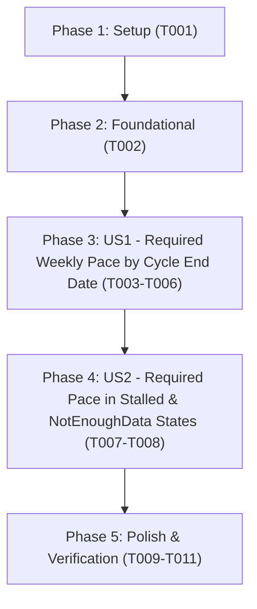

# Tasks: Cycle End-Date Required Pace in Goal Estimation Banner

**Input**: Design documents from `/specs/003-cycle-end-required-pace/`
**Prerequisites**: [plan.md](file:///c:/Users/rogal/workspaces/ws-gym/crosstrainingapp/specs/003-cycle-end-required-pace/plan.md) (required), [spec.md](file:///c:/Users/rogal/workspaces/ws-gym/crosstrainingapp/specs/003-cycle-end-required-pace/spec.md) (required for user stories), [research.md](file:///c:/Users/rogal/workspaces/ws-gym/crosstrainingapp/specs/003-cycle-end-required-pace/research.md), [data-model.md](file:///c:/Users/rogal/workspaces/ws-gym/crosstrainingapp/specs/003-cycle-end-required-pace/data-model.md), [contracts/analytics-contract.md](file:///c:/Users/rogal/workspaces/ws-gym/crosstrainingapp/specs/003-cycle-end-required-pace/contracts/analytics-contract.md), [quickstart.md](file:///c:/Users/rogal/workspaces/ws-gym/crosstrainingapp/specs/003-cycle-end-required-pace/quickstart.md)

**Tests**: Unit and Compose UI test tasks are included to enforce the project's Testing & CI Parity guideline (`GEMINI.md` Guideline 3) and validate all acceptance scenarios in `spec.md`.

**Organization**: Tasks are grouped by user story (`US1`, `US2`) to enable independent implementation, verification, and incremental delivery.

## Format: `[ID] [P?] [Story] Description`

- **[P]**: Can run in parallel (different files, no blocking dependencies)
- **[Story]**: Which user story this task belongs to (`[US1]`, `[US2]`)
- Exact file paths are included in all task descriptions

---

## Phase 1: Setup (Shared Infrastructure)

**Purpose**: Verify the workspace baseline and ensure clean compilation of `FatLossAnalytics.kt` and `ProgressScreen.kt` before applying feature changes.

- [x] T001 Verify clean baseline compilation and unit test execution for `FatLossAnalyticsTest` and `WeightProgressionCardTest` in `app/src/test/java/com/fractanomics/crosstraining/data/analytics/FatLossAnalyticsTest.kt` and `app/src/test/java/com/fractanomics/crosstraining/ui/screens/WeightProgressionCardTest.kt`

---

## Phase 2: Foundational (Blocking Prerequisites)

**Purpose**: Define the `RequiredPaceResult` domain value object and `FatLossAnalytics.computeRequiredPaceToEndDate` calculation engine required by both `US1` and `US2`.

**⚠️ CRITICAL**: No user story work can begin until this phase is complete.

- [x] T002 Define `RequiredPaceResult` (`requiredRateInUnit: Double` strictly negative `<= -0.1`, `remainingWeightInUnit: Double` positive `diff1(round1(toDisplay(today7dAvgKg)), round1(toDisplay(targetWeightKg))) > 0.0`, `daysRemaining: Long` `ChronoUnit.DAYS.between(today, endDate) > 0`, `weeksRemaining: Double` `daysRemaining / 7.0`, `endDate: LocalDate`, `weightUnit: String`, with `formatRate()`, `formatEndDate()`, and `formatSubtitle()` returning `"Required pace: ${formatRate()} (by ${formatEndDate()})"`) and implement `FatLossAnalytics.computeRequiredPaceToEndDate` (direct-value and `entries`/`cycle` overloads) in `app/src/main/java/com/fractanomics/crosstraining/data/analytics/FatLossAnalytics.kt`

**Checkpoint**: Foundational `RequiredPaceResult` and `computeRequiredPaceToEndDate` domain engine are ready — User Story implementation can now proceed.

---

## Phase 3: User Story 1 - Required Weekly Pace to Reach Target Weight by Cycle End Date (Priority: P1) 🎯 MVP

**Goal**: Calculate the required weekly loss pace to reach `targetWeightKg` by `cycle.endDate` in `kg/wk` and `lbs/wk` (reconciled with the 1-decimal `7D AVG - GOAL` remaining weight and exact calendar weeks `daysRemaining / 7.0`) and append `"Required pace: -X.X <kg/wk|lbs/wk> (by <d MMM yyyy>)"` at the bottom of `ForecastBanner` when a cycle end date is defined.

**Independent Test**: Run `.\gradlew.bat testDebugUnitTest --tests "com.fractanomics.crosstraining.data.analytics.FatLossAnalyticsTest" --tests "com.fractanomics.crosstraining.ui.screens.WeightProgressionCardTest" --no-daemon` to verify `computeRequiredPaceToEndDate` and `resolveRequiredPaceSubtitle` in `Projected` state for both `kg` and `lbs`, plus suppression when `endDate == null`, `daysRemaining <= 0`, or `GoalReached`.

### Tests for User Story 1

- [x] T003 [P] [US1] Add unit tests in `FatLossAnalyticsTest` verifying `computeRequiredPaceToEndDate` computes 1-decimal display-reconciled required pace in `kg/wk` and `lbs/wk`, clamps small positive loss rates (`< 0.05/wk`) to `-0.1`, and returns `null` when `cycleEndDate == null`, `today >= cycleEndDate`, `remainingWeightInUnit <= 0.0`, or `targetWeightKg >= startingWeightKg` in `app/src/test/java/com/fractanomics/crosstraining/data/analytics/FatLossAnalyticsTest.kt`
- [x] T004 [P] [US1] Add unit tests in `WeightProgressionCardTest` verifying `resolveRequiredPaceSubtitle` formats `"Required pace: -X.X <kg/wk|lbs/wk> (by <d MMM yyyy>)"` for `PaceForecast.Projected` in `kg` and `lbs` and returns `null` when `cycleEndDate == null`, `today >= cycleEndDate`, `PaceForecast.GoalReached`, or `PaceForecast.CycleEnded` in `app/src/test/java/com/fractanomics/crosstraining/ui/screens/WeightProgressionCardTest.kt`
- [x] T005 [P] [US1] Add Compose UI test in `WeightProgressionCardComposeTest` verifying `ForecastBanner` renders `"Required pace: ... (by ...)"` alongside `"Estimated: ..."` and `"Based on ..."` with zero text overflow at `360dp` width and `fontScale = 1.3f` in `app/src/androidTest/java/com/fractanomics/crosstraining/ui/screens/WeightProgressionCardComposeTest.kt`

### Implementation for User Story 1

- [x] T006 [US1] Implement `resolveRequiredPaceSubtitle` and wire `cycleEndDate = cycle.endDate` (plus `today7dAvgKg = resolvedToday7dAvgKg`, `goalWeightKg = goalWeightKg`, `startWeightKg = startWeightKg`, `referenceDate = referenceDate`) through `WeightProgressionCard`, `WeightProgressionHeroCard`, and `ForecastBanner` in `app/src/main/java/com/fractanomics/crosstraining/ui/screens/ProgressScreen.kt`

**Checkpoint**: User Story 1 is complete and independently verifiable via `FatLossAnalyticsTest`, `WeightProgressionCardTest`, and `WeightProgressionCardComposeTest`.

---

## Phase 4: User Story 2 - Required Pace Visibility During Stalled or Early-Cycle Check-In States (Priority: P2)

**Goal**: Ensure `resolveRequiredPaceSubtitle` and `ForecastBanner` also display `"Required pace: -X.X <kg/wk|lbs/wk> (by <d MMM yyyy>)"` when `forecast` is `PaceForecast.Stalled` or `PaceForecast.NotEnoughData` (whenever at least 1 active in-cycle weigh-in exists, `remainingDisplay > 0.0`, and `daysRemaining > 0`).

**Independent Test**: Run `.\gradlew.bat testDebugUnitTest --tests "com.fractanomics.crosstraining.ui.screens.WeightProgressionCardTest" --no-daemon` to verify `resolveRequiredPaceSubtitle` returns the formatted required pace subtitle for both `PaceForecast.Stalled` and `PaceForecast.NotEnoughData` states when a future `cycleEndDate` and unreached `goalWeightKg` are provided.

### Tests for User Story 2

- [x] T007 [P] [US2] Add unit tests in `WeightProgressionCardTest` verifying `resolveRequiredPaceSubtitle` emits `"Required pace: -X.X <kg/wk|lbs/wk> (by <d MMM yyyy>)"` when `forecast` is `PaceForecast.Stalled` or `PaceForecast.NotEnoughData` (with active in-cycle weight and future `cycleEndDate`), and returns `null` when `today7dAvgKg == null` in `app/src/test/java/com/fractanomics/crosstraining/ui/screens/WeightProgressionCardTest.kt`

### Implementation for User Story 2

- [x] T008 [US2] Ensure `resolveRequiredPaceSubtitle` and `ForecastBanner` allow `PaceForecast.Stalled` and `PaceForecast.NotEnoughData` alongside `PaceForecast.Projected` (suppressing only `PaceForecast.GoalReached` and `PaceForecast.CycleEnded`) in `app/src/main/java/com/fractanomics/crosstraining/ui/screens/ProgressScreen.kt`

**Checkpoint**: Both User Story 1 (`P1`) and User Story 2 (`P2`) are complete and independently verified.

---

## Phase 5: Polish & Cross-Cutting Concerns

**Purpose**: Full pre-PR verification suite (`testDebugUnitTest`, PowerShell script tests, Android lint), `CHANGELOG.md` update, and local APK build/sync per `GEMINI.md`.

- [x] T009 Execute the full Android unit test suite (`.\gradlew.bat testDebugUnitTest --no-daemon`) across `app/src/test/java/com/fractanomics/crosstraining/data/analytics/FatLossAnalyticsTest.kt` and `app/src/test/java/com/fractanomics/crosstraining/ui/screens/WeightProgressionCardTest.kt`
- [x] T010 [P] Execute the PowerShell script regression test suite (`.\scripts\tests\Invoke-ScriptTests.ps1`) and Android lint check (`.\gradlew.bat lintDebug --no-daemon`) in `scripts/tests/Invoke-ScriptTests.ps1`
- [x] T011 Assemble the debug APK (`.\gradlew.bat assembleDebug --no-daemon`), copy the output artifact to `local_test/latest.apk`, and document the feature in `CHANGELOG.md`

---

## Dependencies & Execution Order

### Phase Dependencies

- **Phase 1: Setup (`T001`)**: No dependencies — verifies clean baseline compilation and unit tests.
- **Phase 2: Foundational (`T002`)**: Depends on Phase 1 — defines `RequiredPaceResult` and `computeRequiredPaceToEndDate` in `FatLossAnalytics.kt`. Blocks user story implementation.
- **Phase 3: User Story 1 (`T003`–`T006`, P1 🎯 MVP)**: Depends on Phase 2 — delivers domain tests, UI resolver tests, Compose layout tests, and `ForecastBanner` integration for `Required pace: -X.X <unit>/wk (by <d MMM yyyy>)`.
- **Phase 4: User Story 2 (`T007`–`T008`, P2)**: Depends on Phase 2 and Phase 3 — verifies and enables required pace display during `Stalled` and `NotEnoughData` states.
- **Phase 5: Polish (`T009`–`T011`)**: Depends on completion of Phases 3 and 4.

### User Story Dependencies



### Parallel Opportunities

- **Within User Story 1**: Test tasks `T003` (`FatLossAnalyticsTest.kt`), `T004` (`WeightProgressionCardTest.kt`), and `T005` (`WeightProgressionCardComposeTest.kt`) touch separate test files and can run in parallel.
- **Within Polish Phase**: `T009` (JVM unit tests) and `T010` (PowerShell script tests & lint) can be validated independently before `T011` (`assembleDebug` + `CHANGELOG.md`).

---

## Parallel Example: User Story 1

```bash
# Write domain, UI unit, and Compose UI tests in parallel across separate files:
Task T003: "Add unit tests in FatLossAnalyticsTest for computeRequiredPaceToEndDate in app/src/test/java/com/fractanomics/crosstraining/data/analytics/FatLossAnalyticsTest.kt"
Task T004: "Add unit tests in WeightProgressionCardTest for resolveRequiredPaceSubtitle in app/src/test/java/com/fractanomics/crosstraining/ui/screens/WeightProgressionCardTest.kt"
Task T005: "Add Compose UI test in WeightProgressionCardComposeTest in app/src/androidTest/java/com/fractanomics/crosstraining/ui/screens/WeightProgressionCardComposeTest.kt"
```

---

## Implementation Strategy

### MVP First (User Story 1)

1. Complete **Phase 1: Setup** (`T001`) and **Phase 2: Foundational** (`T002`).
2. Complete **Phase 3: User Story 1** (`T003`–`T006`) to calculate and render `"Required pace: -X.X <kg/wk|lbs/wk> (by <d MMM yyyy>)"` in `ForecastBanner`.
3. **Validate**: Run `FatLossAnalyticsTest` and `WeightProgressionCardTest`.

### Full Delivery

4. Complete **Phase 4: User Story 2** (`T007`–`T008`) to verify and support `Stalled` and `NotEnoughData` banner states.
5. Complete **Phase 5: Polish & Verification** (`T009`–`T011`) to verify 100% green unit/script tests, lint, `CHANGELOG.md`, and sync `local_test/latest.apk`.
